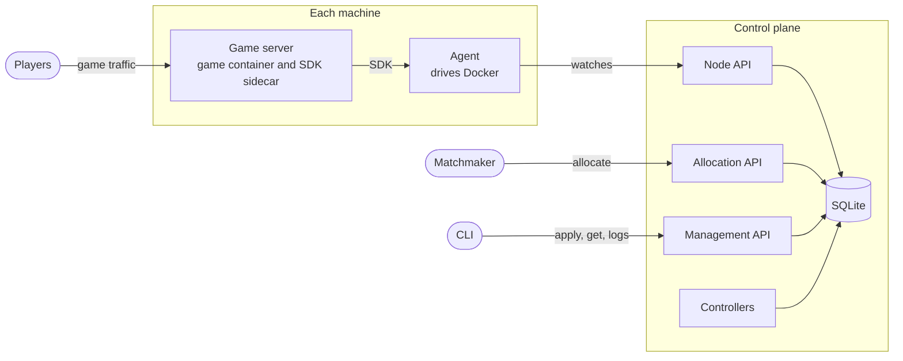

<p align="center">
  <a href="https://github.com/ponyo877/scrim">
    <picture>
      <source media="(prefers-color-scheme: dark)" srcset="docs/images/logo-dark.svg">
      
    </picture>
  </a>
</p>

<p align="center">
  <strong>Game server hosting on plain Docker hosts, compatible with Agones.</strong><br>
  One binary hosts, scales and allocates dedicated game servers, with the SDKs,<br>
  manifests and Allocation API of Agones. There is no cluster to operate.
</p>

<p align="center">
  <a href="https://github.com/ponyo877/scrim/actions/workflows/ci.yml"></a>
  <a href="go.mod"></a>
  <a href="https://github.com/agones-dev/agones/releases/tag/v1.62.0"></a>
  <a href="#project-status"></a>
  <a href="LICENSE"></a>
</p>

<p align="center">
  <a href="#quick-start">Quick start</a> ·
  <a href="#how-it-works">How it works</a> ·
  <a href="#compatibility-with-agones">Compatibility</a> ·
  <a href="#performance">Performance</a> ·
  <a href="#documentation">Documentation</a>
</p>

<p align="center">
  
</p>

---

scrim is one binary that hosts dedicated game servers on machines that have
Docker and nothing else, and is compatible with
[Agones](https://agones.dev/site/). There is no cluster to operate: one
process is the control plane, an agent on each machine starts the
containers, and a SQLite file keeps the state.

What was built for Agones works here unchanged:

- **Game servers.** A container image that uses an official Agones SDK runs
  as it is. The sidecar speaks the same gRPC and REST protocol.
- **Manifests.** `GameServer`, `Fleet` and `FleetAutoscaler` YAML written for
  Agones is accepted, for the subset of the Pod definition that Docker can
  express.
- **Matchmakers.** A client written for the Agones allocator service works
  once it is pointed at scrim, with a token or with the client
  certificate it already has.

So a game can start on a single VM, and move to Agones on Kubernetes when it
outgrows that, without a change to the game server or the matchmaker. A
scrim is a practice match: the same game, on a smaller field.

> [!NOTE]
> **Unofficial.** scrim is an independent project. It is not affiliated
> with or endorsed by the [Agones](https://github.com/agones-dev/agones)
> project. Questions and bug reports about scrim belong in
> [this repository's issues](https://github.com/ponyo877/scrim/issues), not
> in the channels of Agones.

## Why does this project exist?

Agones runs dedicated game servers on Kubernetes, and does it well. It also
needs a Kubernetes cluster, and for a game that fits on one to a few VMs the
cluster is more to operate than the game. That is the case for many small
studios, for prototypes and playtests, and for a region that needs only a
handful of machines.

scrim is for those. It keeps everything a game server and a matchmaker
see of Agones, and replaces what Kubernetes did with the least that does the
job:

| The job | Agones on Kubernetes | scrim |
|---|---|---|
| Keeping the resources | API server and etcd | a SQLite file |
| Starting and watching containers | kubelet | an agent and Docker |
| Choosing a node and its ports | kube-scheduler | a small scheduler of its own |
| Defaults and validation | admission webhooks | the same Agones code, called directly |
| Day-to-day operation | `kubectl`, Helm | the `scrim` CLI |

**When to use Agones instead.** scrim has one control plane, and it is made
for about ten machines. A game that needs more machines than that, a
control plane that survives the loss of its machine, allocation across
clusters, or anything else that Kubernetes brings, is a game for Agones.

## Features

- **`GameServer`, `Fleet` and `GameServerSet`**, with rolling updates
- **Allocation** over gRPC and REST, on the same API as the Agones allocator.
  A matchmaker that names its request with an annotation can ask again
  after a timeout and is given the same game server, not a second one
- **`FleetAutoscaler`** with the Buffer, Counter, List, Webhook, Schedule and
  Chain policies
- **The SDK**: every stable and beta call, Counters and Lists included, over
  gRPC, REST and WebSocket
- **Several machines**: agents join with a token. A machine that goes quiet
  has its idle game servers replaced and its running sessions kept
- **Maintenance**: `cordon` and `drain` take a machine out of service without
  ending a session
- **Security**: TLS on every API, a token for each role, and a join token
  that pins the control plane's certificate authority
- **Observability**: Prometheus metrics, an event history, and game server
  logs through the CLI. `/healthz` says when nothing can be saved, and
  `scrim buffer` works out the `bufferSize` for a rate of allocations
- **Private registries**, with the credentials that `docker login` stored

## How it works



- The **control plane** keeps the state and decides what should run. It
  serves the management API, the Allocation API and the API for agents.
  `scrim server` starts it.
- An **agent** runs on every machine. It has Docker create the containers of
  the game servers placed there, and reports what became of them.
  `scrim agent` starts it.
- A **sidecar** runs beside every game server and is what the game server's
  SDK talks to.
- The **CLI** is the same binary.

`scrim server` runs an agent inside itself, so one VM needs one
process. Every connection is made from the inside out: sidecar to agent,
agent to control plane. The only ports a machine has to open are the ones
players connect to.

## Quick start

You need a machine with Docker. Download the binary for it from the
[latest release](https://github.com/ponyo877/scrim/releases/latest)
and start the control plane:

```sh
# Linux on amd64. There are also linux-arm64, darwin-arm64 and darwin-amd64.
curl -fsSLo scrim https://github.com/ponyo877/scrim/releases/latest/download/scrim-linux-amd64
chmod +x scrim
./scrim server
```

In another terminal, apply the sample Fleet of Agones and take a game server
from it, as a matchmaker would:

```sh
examples=https://raw.githubusercontent.com/agones-dev/agones/v1.62.0/examples/simple-game-server
curl -fsSL $examples/fleet.yaml | ./scrim apply -f -
./scrim get gameservers
./scrim allocate --fleet simple-game-server
```

```text
NAME                             STATE   ADDRESS     PORT   NODE      AGE
simple-game-server-96p7v-dt658   Ready   127.0.0.1   7000   my-host   9s
simple-game-server-96p7v-ggpt7   Ready   127.0.0.1   7001   my-host   9s
simple-game-server-96p7v-dt658 127.0.0.1 7000
```

Let the Fleet grow and shrink by itself, then look at what happened:

```sh
curl -fsSL $examples/fleetautoscaler.yaml | ./scrim apply -f -
./scrim get gameservers -w          # every change, until Ctrl-C
./scrim describe fleet simple-game-server
./scrim logs simple-game-server-96p7v-dt658
```

If Docker does not listen on `/var/run/docker.sock` (Colima, for example),
point `DOCKER_HOST` at its socket first:

```sh
export DOCKER_HOST="unix://$HOME/.colima/default/docker.sock"
```

To build it yourself, you need Go and `make` as well:

```sh
git clone --recurse-submodules https://github.com/ponyo877/scrim.git
cd scrim
make build sidecar-image    # bin/scrim, and the sidecar image it uses
```

The samples are then in `third_party/agones/examples/simple-game-server`.

Releases after v0.2.0 also carry `checksums.txt`, a software bill of
materials for each binary, and a signed record that the release workflow
of this repository built them from the tagged commit. To check a binary
you downloaded (the rest is in [SECURITY.md](SECURITY.md#verifying-a-release)):

```sh
gh attestation verify scrim --repo ponyo877/scrim
```

## Running on more machines

The control plane listens for agents once it is given an address for them.
The join token carries the fingerprint of the control plane's certificate
authority, so an agent cannot be pointed at an impostor.

```sh
# on the control plane's machine
scrim server --node-listen 0.0.0.0:9445 --tls-san cp.example.com
scrim token show join

# on every further machine
scrim agent --server cp.example.com:9445 --token-file join-token \
    --address 203.0.113.11
```

`scrim node cordon`, `drain` and `delete` take a machine out of
service. [deploy/](deploy) has systemd units and example configuration files.

Two things have to get through firewalls: players to the game server ports
of every machine (7000 to 8000 unless set otherwise), and agents to the
control plane's `--node-listen` port. On Linux the sidecars reach their
agent through a unix socket, so the host's own firewall is not in the way.

## Compatibility with Agones

Compatibility is pinned to **Agones v1.62.0**. scrim uses the Agones
API types and their own defaulting and validation as a Go module, so a
manifest means here what it means there. scrim moves to each new release of
Agones before the one after it comes out
([how](docs/agones.md#following-new-releases-of-agones)).

| Works as in Agones | Left out on purpose |
|---|---|
| `GameServer` (development ones too), `Fleet`, `GameServerSet`, `FleetAutoscaler` | `kubectl`, Helm and CRDs |
| The SDK protocol: gRPC, REST and WebSocket | A redundant control plane |
| The allocator's gRPC and REST API | Allocation across clusters |
| Counters and Lists, in the SDK, in allocation and in autoscaling | Features that are Alpha or Dev in Agones |
| Rolling updates and the `Recreate` strategy | Windows containers |
| Health checks, `Reserve`, graceful shutdown | `initContainers`, and volumes from `configMap` or `secret` |
| Packed and Distributed scheduling, and named port ranges | Adding and removing the VMs themselves |

The sample images of the C++, Node.js, Rust and Unity SDKs run unchanged.
So do the conformance clients that Agones runs for each of its SDKs: Go,
REST and WebSocket, Python, C#, Node.js, Rust and C++. CI builds them from
the Agones source, unchanged, and runs each as a scrim game server until it
shuts itself down.

CI also installs Agones v1.62.0 in a kind cluster, makes the same game
servers, allocations and Fleet changes there and on scrim, and compares
what the two answer and store, field by field. Only what cannot be the same
is left out before the comparison: addresses, ports, node names, times, the
random part of generated names, scrim's own annotations, and the
`immutableReplicas` that the Agones CRD adds for Kubernetes. One difference
is kept on purpose, in how far a rolling update scales down an old
GameServerSet that is busy with sessions, and the comparison names it
instead of hiding it.
[docs/agones.md](docs/agones.md) lists every place where scrim differs from
Agones, for a game server, a manifest, a matchmaker and an operator, and
what to change when moving from one to the other.

## Performance

scrim is designed for 10 machines, 1,000 game servers and 50
allocations a second, and is held to that in CI. Measured on **one arm64
core** with a disk that takes 1.5 ms to sync:

| What was measured | Result |
|---|---|
| A Fleet of 1,000 game servers, until all are Ready | about 1 second |
| A Fleet of 10,000 game servers, until all are Ready | about 10 seconds |
| An allocation, at 50 a second | 2.7 ms median, 7.8 ms at the 99th percentile |
| Allocations by 64 matchmakers that do not pause | 1,000 to 1,500 a second |

These are the control plane's numbers, with simulated machines; with real
containers Docker sets the pace. Its heap is about 17 MB with 1,000 game
servers and 60 MB with 10,000. An allocation is answered only after it is
on disk: what a matchmaker was told outlasts a crash. The design document
says where the time goes.

When the disk stalls, requests are refused at once instead of piling up, so
that matchmakers which time out and ask again do not use up the game
servers they are asking for.

```sh
# 1,000 game servers on 10 simulated machines, 50 allocations a second
SCRIM_LOAD=1 go test ./pkg/controlplane/ -run TestLoad -v

# How fast it goes at most
go test ./pkg/controlplane/ -run '^$' -bench ScaleUp -benchtime 3x
go test ./pkg/controlplane/ -run '^$' -bench Allocate -benchtime 3000x
```

## How it is tested

Tests of examples say that what was thought of works. Four more kinds look
for the input, or the order of events, that nobody thought of:

- **Properties and models.** What must hold for any input is tried on random
  ones. Whole runs of the control plane, with machines lost and restarts in
  the middle, are checked for what must never happen.
- **Fuzzing** of everything that takes bytes from outside: manifests,
  configuration, tokens, and what Docker answers.
- **Proofs.** The port allocator, Counters, the game server state machine and
  rolling updates have models in Lean 4 with proofs about them, and Go tests
  replay what the models answer against the real functions.
- **Model checking.** What changes state, and in what order it may happen, is
  written out in ten Quint models: the life of a game server, its SDK
  requests on their way, an agent's containers, the store's file. TLC goes
  through every state each of them can reach. It found two faults in the
  code, which are mended.

```sh
go test ./pkg/fleets/ -run Rollout -rapid.checks=100000
go test ./pkg/apiserver/ -run '^$' -fuzz FuzzAdmit -fuzztime 5m
cd formal && lake build
make models
```

It has also run on real machines: five Linux hosts in two regions, arm64 and
amd64, with a hundred real game servers, and with agents and the control
plane killed and cut off on purpose.

Where a paper says how something is done well, the code says which: what
to do when the disk fails, when to refuse a request, how to measure a tail,
when not to trust a failure detector. The design document also lists what
was looked at and left out, and why.

Nothing reaches `main` without passing
[CI](.github/workflows/ci.yml): the linters, the tests under the race
detector on Linux amd64, Linux arm64 and macOS, a thousand tries of every
property, the fuzz targets, the load test, the proofs, the models, a scan
for known vulnerabilities, the Agones conformance clients of every SDK, the
comparison with Agones itself, and the quick start above with real
containers. A release
is tried the same way once it is out, with the binary and the sidecar
image that were published.

## Project status

scrim is **pre-1.0**. Everything planned for the first version is in
place and tested, but nothing has run in production yet.

- **Production target:** Linux on amd64 and arm64 (tried on Ubuntu 24.04
  with Docker 29).
- **Development:** macOS with Colima.
- **Known limits** are listed in the design document. The ones to know
  first: there is one control plane and it is not redundant, though game
  servers and their sessions keep running while it is down; and of a
  `GameServer` that exists, only the labels and annotations can be
  changed (`scrim label`, `scrim annotate`).

## Documentation

The code is meant to be read. Functions are kept small (a cognitive
complexity of 10 or less, checked in CI), and packages are named after their
Agones counterparts so the two can be read side by side.
`third_party/agones` holds the matching Agones source for that purpose; the
build does not use it. Start with `pkg/store`, then
`pkg/gameservers/state.go`.

| Document | What it covers |
|---|---|
| [docs/agones.md](docs/agones.md) | Where scrim differs from Agones, and moving between the two |
| [docs/planning.md](docs/planning.md) | Goals, scope and the record of decisions (Japanese) |
| [docs/design.md](docs/design.md) | Architecture, every component, and a reading order for the code (Japanese) |
| [formal/README.md](formal/README.md) | What is proved and what is model-checked, and what is not (Japanese) |
| [deploy/](deploy) | systemd units and example configuration |
| [Agones documentation](https://agones.dev/site/docs/) | The SDKs, the manifests and the Allocation API themselves |

## Contributing

Issues and pull requests are welcome.
[CONTRIBUTING.md](CONTRIBUTING.md) says how to build, what the code is held
to, and what CI will ask of a change. To report a security issue, please
follow [SECURITY.md](SECURITY.md) and do not open a public issue.

```sh
make test   # all tests; the Docker tests run when a daemon is reachable
make lint   # golangci-lint: the complexity limits, mistakes, security
make check  # what CI checks before a change reaches main, as far as one machine can
make proto  # regenerate code for the protocols in proto/
make dist   # release binaries for every platform, into dist/
```

## License

[Apache-2.0](LICENSE), the same as Agones. scrim uses the Agones API
types and generated SDK code as a Go module, and parts of its logic are
ported from Agones; those places name the file they come from.

Agones is a project of its own authors, and its name is a trademark of
LF Projects, LLC. scrim only builds on it, with thanks, and uses the name
only to say what it is compatible with.
