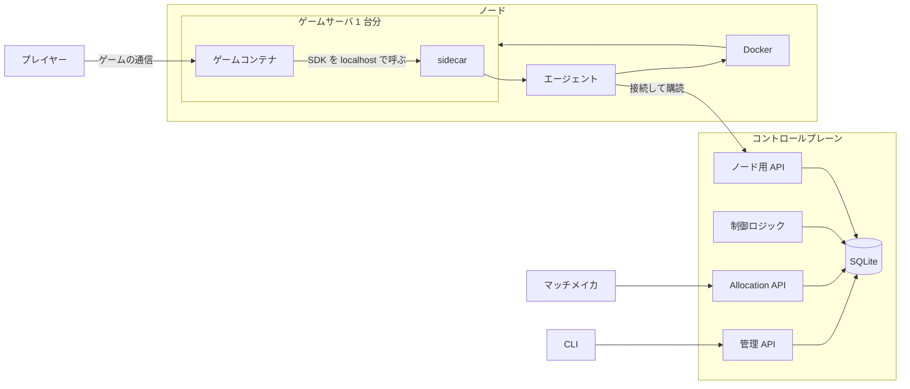
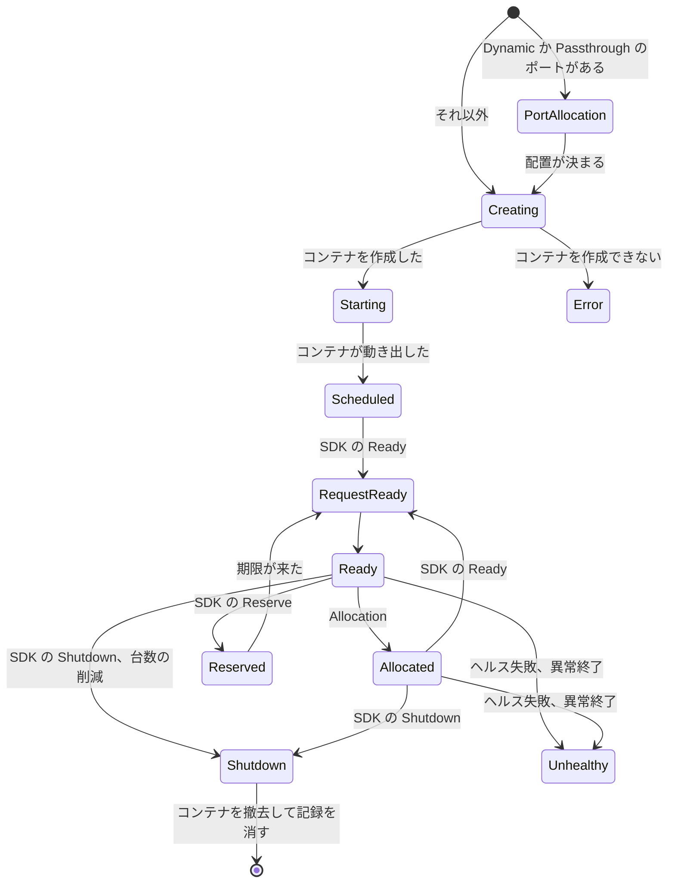
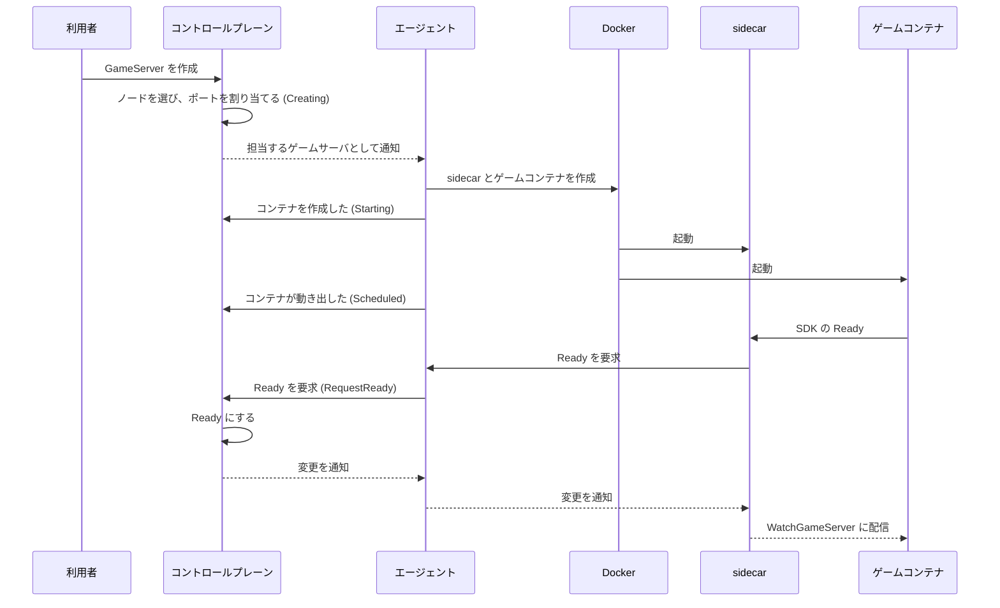

# scrim 設計書

この文書は、scrim の作り方を定める。
何を作り、何を作らないかは [企画書](planning.md) に書いた。

互換の基準は Agones v1.62.0 である。
本文で「本家」と書いたときは、このバージョンの Agones を指す。
本家のファイルは、submodule として置いた `third_party/agones` からの相対パスで示す。

## 全体の構成

scrim は 4 つの部品でできている。

- **コントロールプレーン**：状態を保存し、あるべき状態を決める。管理 API、Allocation API、ノード用 API を提供する。`scrim server` で起動する。
- **エージェント**：各ノードで動き、そのノードが担当するゲームサーバのコンテナを Docker に作らせ、結果を報告する。`scrim agent` で起動する。
- **sidecar**：ゲームサーバ 1 台につき 1 つ動く小さなコンテナで、ゲームサーバが SDK で話す相手になる。
- **CLI**：管理 API を呼ぶコマンド群で、本体と同じバイナリに入っている。



コントロールプレーンは 1 台だけ置く。
`scrim server` は既定でエージェントを同じプロセスの中で動かすので、VM が 1 台ならこれだけで足りる。
ノードを増やすときは、追加の VM で `scrim agent` を起動する。

通信の向きは、すべてノードの内側から外側へ向かう。
sidecar はエージェントに接続し、エージェントはコントロールプレーンに接続する。
コントロールプレーンからノードへ接続することはないので、ノード側で受信ポートを開ける必要があるのはゲームの通信だけになる。

## Kubernetes の仕事を何で置き換えるか

本家は多くの仕事を Kubernetes に任せている。
scrim はそれを次のように置き換える。

| 仕事 | 本家での担い手 | scrim での担い手 |
|---|---|---|
| リソースの保存と楽観ロック | API サーバと etcd | SQLite とメモリ上の写し（`pkg/store`） |
| 変更の通知 | informer | store の購読 |
| 重複を除いた再試行つきの作業キュー | client-go の workqueue | `pkg/queue` |
| 既定値の付与と検証 | admission webhook | 管理 API のハンドラが型のメソッドを直接呼ぶ |
| ノードの選択 | kube-scheduler | `pkg/scheduling` |
| ポートの衝突回避 | kube-scheduler と portallocator | `pkg/portallocator` |
| コンテナの起動と監視 | kubelet | エージェント（`pkg/agent`）と Docker |
| Pod | Pod | sidecar コンテナ 1 つとゲームコンテナ群 |
| 親子関係と連鎖削除 | ownerReference とガベージコレクタ | ownerReference を保持し、子の制御が親の消失を見て自分を消す |
| 削除の後始末 | finalizer | 削除要求の印を付け、コンテナの撤去を確認してから記録を消す |
| 出来事の記録 | Event | イベント履歴（`pkg/events`） |
| ノードの台帳 | Node | scrim 独自の Node リソース |

## リソースモデル

リソースの型は本家の Go 型をそのまま使う。
GameServer、GameServerSet、Fleet は `agones.dev/agones/pkg/apis/agones/v1` の型、FleetAutoscaler は `pkg/apis/autoscaling/v1` の型である。
JSON の形が本家と同じになるので、本家向けの YAML をそのまま読める。

`metadata` の各項目は次のように扱う。

| 項目 | 扱い |
|---|---|
| `name`、`generateName` | 本家と同じ。`generateName` だけが指定されたら末尾に乱数を付ける |
| `namespace` | 名前の区画として保持する。省略時は `default` |
| `uid` | 作成時に生成する |
| `resourceVersion` | store の版番号。更新時に一致しなければ競合として拒否する |
| `generation` | `spec` が変わるたびに 1 増やす |
| `creationTimestamp` | 作成時に記録する |
| `deletionTimestamp` | 削除要求を受けたときに記録する。記録は後始末が済んでから消す |
| `labels`、`annotations` | 本家と同じ |
| `ownerReferences` | Fleet と GameServerSet、GameServerSet と GameServer の親子関係を表す |

GameServerAllocation は保存しない。
Allocation API のリクエストとして受け取り、結果を応答として返すだけである。

### Node リソース

本家にないリソースとして **Node** を追加する。
エージェントが接続したときにコントロールプレーンが作り、ノードの容量と状態を表す。

```yaml
apiVersion: scrim/v1
kind: Node
metadata:
  name: node-1
spec:
  unschedulable: false        # cordon すると true になる
  drain: false                # drain すると true になる
status:
  phase: Ready                # Ready または Disconnected
  address: 203.0.113.10       # プレイヤーが接続するアドレス
  capacity:
    cpu: "8"
    memory: 16Gi
  maxGameServers: 100
  portRange: {min: 7000, max: 8000}
  lastHeartbeatTime: "2026-11-23T10:00:00Z"
  version: v1.0.0
```

### 既定値の付与と検証

管理 API は、受け取ったリソースに対して型のメソッド `ApplyDefaults()` と `Validate()` を呼ぶ。
本家では admission webhook が同じメソッドを呼んでいるので、判定の結果は本家と一致する。

`Validate()` には、クラウド製品ごとの追加検証を差し込むための `APIHooks` を渡す必要がある。
scrim は、何も検証しない実装を渡す。

本家の型のメソッドは feature gate を参照する。
本家の feature gate は、初期化しないとすべて無効として扱われる（`pkg/util/runtime/features.go` の `FeatureEnabled`）。
scrim は起動時に `ParseFeatures("")` を呼び、v1.62.0 の既定値で固定する。
利用者が gate を切り替える手段は用意しない。

本家の既定値は、GameServer と Fleet の注釈 `agones.dev/sdk-version` に本家の版を書く。
その版は本家のビルドが埋め込むもので、埋め込まなければ `dev` になる。
scrim は同じ起動時の処理で v1.62.0 を入れる（`pkg/agones`）。

`Validate()` だけでは足りない。
本家の検証は、Kubernetes の API サーバが CRD のスキーマで先に検査を済ませていることを前提にしている。
負の `replicas`、範囲外のポート番号、DNS の名前として使えない名前は、スキーマが止めるので、`Validate()` は調べない。
scrim にはその API サーバがないので、スキーマの制約のうち、実行に影響する項目を自分で検査する（`pkg/apiserver/schema.go`）。
スキーマが与える既定値も同じ場所で付ける。
容量を省いた Counter と List は 1000 になり、値を省いた List の `values` は空の配列になる。
`priorities` の `order` を省くと Ascending になる。

Fleet のテンプレートは、書かれたまま（スキーマの既定値だけを付けて）保存する。
`Fleet.Validate()` は、検査しながらテンプレートに本家の既定値を付ける。
本家ではこれを検証用の webhook が呼ぶので、付けた既定値は保存されない。
scrim は写しを検査する。
本家の既定値は、テンプレートから GameServer を作るときに付く。
この扱いより前の版で保存した Fleet は、テンプレートに既定値が付いている。
同じマニフェストを適用し直すと、テンプレートが変わったものとして、GameServer が一度入れ替わる。

受け付けは次の順に進む。

1. 利用者が書いた `status` と削除の印を捨てる。どちらも制御が書くものである。
2. テンプレートの `metadata` を、ラベルとアノテーションだけにする。捨てた項目は警告として返す。`ownerReferences` などが残っていると、子のリソースの親子関係が壊れる。
3. 既定値を付ける。
4. スキーマの制約、本家の `Validate()`、Pod 定義の検査を行い、見つかった誤りをまとめて返す。

名前には Kubernetes と同じ規則を適用する。
GameServer の名前は、コンテナやボリュームの名前の一部になる。
`_` を区切りに使っているので、名前に `_` が入ると、ある GameServer の後始末が別の GameServer のボリュームを消してしまう。

受け付けたものが後段を壊さないことは、Fuzzing で確かめている（「テスト」の節）。
この変更より前に保存されたリソースは、検査し直さない。

### Pod 定義のうち対応する範囲

本家の GameServer は、`spec.template` に Kubernetes の Pod 定義を丸ごと持つ。
Docker で表現できるのはその一部なので、項目を 3 つに分けて扱う。

次の項目は解釈して実行に反映する。

| 項目 | Docker での表現 |
|---|---|
| `containers[].name`、`image`、`command`、`args`、`workingDir` | コンテナの同名の設定 |
| `containers[].env`（値を直接書いたもの） | 環境変数 |
| `containers[].ports` | 保持するだけで、公開はしない。公開するポートは GameServer の `spec.ports` で決まる。`hostPort` と `hostIP` の指定は拒否する |
| `containers[].resources`（`cpu` と `memory`） | `limits` は CPU とメモリの制限にする。`requests` はノード選択の計算にだけ使う。CPU の制限は、kubelet と同じく 10m を下限にする。メモリの制限は、Docker が受け付ける 6Mi 以上に限る |
| `containers[].volumeMounts` と `volumes[]`（`emptyDir`、`hostPath`） | `emptyDir` はゲームサーバごとのボリューム、`hostPath` はバインドマウント |
| `containers[].imagePullPolicy` | イメージを取得するかどうかの判断 |
| `containers[].securityContext` の `runAsUser`、`runAsGroup`、`readOnlyRootFilesystem` | コンテナの同等の設定 |
| `terminationGracePeriodSeconds` | 停止時に強制終了するまでの猶予 |

Pod テンプレートの `metadata`（ラベルとアノテーション）は、そのまま保持する。
実行には影響しない。

次の項目は、無視しても実行内容が変わらないので、警告を返して無視する。

- `nodeSelector`、`affinity`、`tolerations`、`topologySpreadConstraints`、`schedulerName`、`priorityClassName`
- `serviceAccountName`、`automountServiceAccountToken`
- `imagePullSecrets`（イメージ取得の認証は各ノードの Docker の設定に従う）
- `restartPolicy`（コンテナは常に再起動しない）
- Pod 全体の `resources`（Kubernetes でも Alpha の機能で、本家の Unity のサンプルが指定している）
- `emptyDir` の `medium` と `sizeLimit`、`hostPath` の `type`
- GameServer の `spec.eviction`

上のどちらにも挙げていない項目が指定されていたら、エラーとして拒否する。
無視すると挙動が変わるためである。
代表的なものを挙げる。

- `initContainers`、`ephemeralContainers`
- `emptyDir` と `hostPath` 以外のボリューム
- `env[].valueFrom`、`envFrom`
- `livenessProbe`、`readinessProbe`、`startupProbe`、`lifecycle`
- `hostNetwork`、`hostPID`、`hostIPC`、`shareProcessNamespace`
- `securityContext.privileged`
- `cpu` と `memory` 以外の資源

対応している項目でも、Docker が実行できない値は拒否する。
相対パスや `:` を含むパス、`/` へのマウント、同じ場所への二重のマウント、名前が空か `=` を含む環境変数、負の猶予時間、同じ名前のコンテナ、sidecar と同じ名前のコンテナがこれにあたる。
Kubernetes なら Pod の作成で失敗して GameServer が Error になるところを、適用の時点で、どの項目が悪いかを添えて返す。

FleetAutoscaler の Webhook ポリシーは `url` による指定だけに対応する。
Kubernetes の Service を指す `service` による指定は拒否する。

## 状態の保存と変更の通知

状態は `pkg/store` が管理する。
store は SQLite のファイルと、その内容をすべて載せたメモリ上の写しを持つ。

読み取りはメモリ上の写しから行う。
プロセスは 1 つなので、すべての書き込みが store を通るかぎり、写しは SQLite と食い違わない。

### 2 種類の読み取り

読み取りには 2 つの形がある。

- **Get と List**：呼び出し側だけの複製を返す。受け取ったものは自由に書き換えられ、そのまま更新に使える。
- **View と Peek**：保存されているオブジェクトそのものを、複製せずに返す。View は全体を、Peek は 1 件を返す。読むだけに使い、書き換えるわけにはいかない。

View は性能のためにある。
Allocation や各制御は、変更があるたびにゲームサーバ全体を見渡す。
最初の実装は List だけを持ち、そのたびに全台を複製していた。
負荷試験にかけると、1,000 台が Ready になるまでに 1 分半かかり、割り当ての応答は秒の単位になった。
全体を見渡す箇所を View に切り替えると、それぞれ約 1 秒と数ミリ秒になった。

View を安全にしているのは、store が保存済みのオブジェクトを書き換えないことである。
更新は、新しいオブジェクトへの差し替えとして行う。
そのため、以前に取った View は、取った時点の姿を示し続ける。

### グループ

制御の多くが必要とするのは、GameServer の一部である。
あるノードにある GameServer、ある GameServerSet が持つ GameServer、あるノードにある Ready の GameServer、といった一部である。
View で全体を見渡して探すと、1 万台を 100 のノードに置いた規模では、100 台を見つけるために毎回 1 万台を見ることになる。
しかも、その探索は GameServer が 1 台変わるたびに走る。

そこで store は、ある種類のリソースを、リソースから決まる値でグループに分けて持つ（`store.By`）。
グループは書き込みのたびに更新するので、読む側は目的のグループだけを受け取れる。
グループの大きさだけを尋ねることもできる。
ノードごとの Ready と Allocated の台数は、これで数える。

グループの中の 1 つを、位置を指定して取り出すこともできる（`store.Member`）。
グループは、メンバーを並べた列と、各メンバーが列のどこにいるかの表で持つ。
加えるときは列の末尾に置く。
外すときは、末尾のメンバーを空いた位置へ移す。
どちらも、ほかのメンバーを見ない。
位置に意味はなく、グループが変わると位置も変わる。
この操作は、1 つを無作為に選ぶためにある。
Distributed の割り当てが使う（「Allocation」の章）。

グループが返すのも、View と同じく保存されているオブジェクトそのもので、読むだけに使う。

### 書き込み

書き込みは次の順に進む。

1. store 全体のロックを取る。
2. 渡されたリソースの `resourceVersion` が現在の版と一致するか確かめる。一致しなければ競合エラーを返す。
3. 版番号を 1 進め、メモリ上の写しを差し替える。
4. その変更を、ファイルへ書く順番待ちに加える。

ファイルへ書くのは、裏で動く 1 つの処理（`Store.Run`）である。
順番待ちにたまった変更を 1 つのトランザクションにまとめて SQLite に書き、ディスクへ同期させる。
書き終えたら、購読者にその変更を通知し、次のまとまりに取りかかる。
同じまとまりの中で同じリソースが何度も変わっていれば、最後の版だけを書く。

最初の実装は、書き込みのたびに、ロックを持ったままディスクへの同期を待っていた。
同期には 1 ミリ秒から 2 ミリ秒かかり、その間はほかの誰も書けない。
1,000 台の Fleet を立ち上げると、所要時間の大半は同期を待つ時間だった。
まとめて書けば、同期の回数は書き込みの回数よりずっと少なくて済む。

この方式では、メモリがファイルより先に進む。
異常終了すると、ファイルに届いていなかった変更は失われる。
そこで、外へ何かを約束する所は、答える前にファイルが追いつくのを待つ（`Sync`）。

- 管理 API は、応答の最初の 1 バイトを送る前に待つ。
- Allocation は、割り当てた結果を返す前に待つ。
- エージェントと sidecar からの報告は、受け取ったと答える前に待つ。エージェントに担当の GameServer を渡すときも、渡す前に待つ。
- 購読者への通知は、ファイルに書いた後にだけ行う。

異常終了で失われるのは、外の誰にも伝えていない変更だけになる。
割り当ての応答を受け取ったマッチメイカが、再起動後にその GameServer を Ready として見つけることはない。

待つ側は並んで待てる。
64 件の割り当てが同時に来れば、GameServer を選ぶのは 1 件ずつだが、ファイルへの書き込みは 1 回で済む。

ファイルへの書き込みが失敗したときは、成功するまでやり直す。
その間は、外への約束が止まる。
`Sync` は、ファイルが追いつくか、呼び出した側が待つのをやめるまで返らない。
待つのをやめた相手には何も約束していないので、その変更が後から保存されても約束は破れない。

store は、ファイルがどれだけ遅れているかを答える（`Lag`）。
まだファイルにない変更のうち、いちばん古いものが待っている時間である。
ふだんは数ミリ秒で、これが伸びるのは、ディスクが遅いか、止まっているか、書き込みを拒んでいるときである。
この値は 3 か所で使う。

- Allocation は、遅れが 1 秒を超えていたら要求を断る（「Allocation」の章）。
- `/healthz` は、遅れが 10 秒を超えていたら 503 を返す（「API」の章）。
- メトリクスは、遅れをそのまま出す（`scrim_store_lag_seconds`）。

失敗した保存をやり直すことについては、分かっていることと、分かっていないことがある。
Linux のファイルシステムは、ディスクへの同期（fsync）に失敗すると、書けなかったページを書き込み済みとして扱う。
そのため、同じ内容にもう一度 fsync をかけると、何も書かれないまま成功が返る[^fsync]。
store のやり直しは、fsync をかけ直すのではなく、トランザクションを最初から書き直す。
この形のやり直しを SQLite について調べた研究は、見つけられなかった。
同じ研究は、fsync の失敗の後で安全に続行できたアプリケーションはなかったと結論している。
WAL モードの SQLite で起きたのは、失敗と報告された変更が再起動の後に残っている、という結果だった。
この store では、失敗した変更は誰にも約束していないので、残っていても約束は破れない。

保存できない状態が続いても、プロセスは止めない。
止めて起動し直しても、読み直すのは同じファイルであり、それで直るものがないためである。
代わりに、保存できていないことを外から見えるようにする（上の 3 か所）。

この保証には、すでに名前が付いている。
異常終了で失われるのは末尾の変更だけで、残ったものは矛盾しない、という性質は buffered durable linearizability と呼ばれる[^bdl]。
外に見える出力を、それが依拠する変更が保存されるまで遅らせるやり方は、external synchrony と呼ばれる[^xsync]。

[^fsync]: Rebello, Patel, Alagappan, Arpaci-Dusseau, Arpaci-Dusseau, "Can Applications Recover from fsync Failures?", USENIX ATC 2020。
[^bdl]: Izraelevitz, Mendes, Scott, "Linearizability of Persistent Memory Objects Under a Full-System-Crash Failure Model", DISC 2016。
[^xsync]: Nightingale, Veeraraghavan, Chen, Flinn, "Rethink the Sync", OSDI 2006。

`Store.Run` を動かしていない store は、書き込みのたびに自分でファイルへ書き、失敗すればメモリの変更を取り消す。
制御を 1 手ずつ進めるテストは、この形で動かす。

版番号は store 全体で 1 本の通し番号にする。
リソースごとに番号を持つより単純で、変更の前後関係がそのまま番号の大小になる。

メモリに置くのは、渡されたリソースそのものではなく、ファイルに書く内容を読み直したものである。
JSON は時刻を秒までしか持たず、空のリストは「なし」として戻ることがある。
渡されたものをそのまま置くと、再起動の前と後で store の答えが変わる。
たとえば、同じ 1 秒のうちに作られた 2 つの GameServer は、再起動の前は作成順に、後は名前順に並ぶ。
台数を減らすときに消える GameServer が、再起動をまたいで変わってしまう。

時刻と、自動で付ける名前の末尾は、store が与える。
制御と API は、自分で時計を読まずに store に時刻を尋ねる。
テストは store の時計と名前を差し替えるだけで、コントロールプレーン全体を同じ手順で何度でも動かせる。

「読んで、変えて、書く」という一連の操作には `Change` を使う。
`Change` は、書く時点で他の誰かが先に更新していたら、読むところからやり直す。
制御のコードは、競合の処理を自分で書かずに済む。

削除には 2 つの操作がある。
`MarkDeleted` は「消してよい」という印（`deletionTimestamp`）を付けるだけで、記録は残す。
その記録を持つ制御が後始末を済ませてから、`Delete` で記録を消す。
Kubernetes の finalizer と同じ役割である。

store の Go のインタフェースは、種類ごとの型を付けた次の形で使う。

```go
func (t Typed[T]) Get(namespace, name string) (T, bool)
func (t Typed[T]) List(namespace string) []T // private copies, sorted by name
func (t Typed[T]) View(namespace string) []T // shared with the store: read only
func (t Typed[T]) Peek(namespace, name string) (T, bool) // shared with the store: read only
func (t Typed[T]) Create(obj T) (T, error)
func (t Typed[T]) Update(obj T) (T, error) // ErrConflict on a stale resourceVersion
func (t Typed[T]) Change(namespace, name string, change func(T) (keep bool)) error
func (t Typed[T]) MarkDeleted(namespace, name string, now time.Time) error
func (t Typed[T]) Delete(namespace, name string) error
func (t Typed[T]) Watch() (events <-chan Event, cancel func())
func (t Typed[T]) ListAndWatch(namespace string) (objects []T, events <-chan Event, cancel func())
func (t Typed[T]) Sync(ctx context.Context) error // returns when the file has every change made so far, or ctx is done
func (t Typed[T]) Lag() time.Duration             // for how long the file has been behind

func Group[T Object, G comparable](t Typed[T], by By[T, G], group G) []T // shared: read only
func GroupSizes[T Object, G comparable](t Typed[T], by By[T, G]) map[G]int
func Member[T Object, G comparable](t Typed[T], by By[T, G], group G, place int) (T, bool)
```

### SQLite のテーブル

テーブルは 3 つある。
リソース本体と版番号は `pkg/store` が、イベント履歴は `pkg/events` が、同じファイルの中に持つ。

```sql
-- リソース本体。data は本家互換の JSON
CREATE TABLE resources (
  kind      TEXT    NOT NULL,
  namespace TEXT    NOT NULL,
  name      TEXT    NOT NULL,
  version   INTEGER NOT NULL,
  data      BLOB    NOT NULL,
  PRIMARY KEY (kind, namespace, name)
);

-- 版番号
CREATE TABLE meta (
  key   TEXT PRIMARY KEY,
  value BLOB NOT NULL
);

-- イベント履歴。24 時間たったものを消す
CREATE TABLE events (
  id        INTEGER PRIMARY KEY AUTOINCREMENT,
  time      INTEGER NOT NULL,
  kind      TEXT NOT NULL,
  namespace TEXT NOT NULL,
  name      TEXT NOT NULL,
  type      TEXT NOT NULL,   -- Normal または Warning
  reason    TEXT NOT NULL,
  message   TEXT NOT NULL
);
```

SQLite は WAL モードで開き、リソースの書き込みはコミットのたびにディスクへ同期させる。
同期を省くと、電源断の直前に行った割り当てが失われ、対戦中のゲームサーバがもう一度割り当てられるおそれがある。
イベント履歴は同期させない。
人が読むための記録で、異常終了の直前の数件が欠けても困らないためである。

## 制御ロジックの書き方

Fleet の台数を保つ、ゲームサーバを起動する、といった「あるべき状態に合わせ込む」処理を **制御** と呼ぶ。
scrim の制御は、どれも同じ 2 層の形で書く。

- **判断**：現在の状態を引数で受け取り、行うべき操作の一覧を返す純粋関数。store も Docker も時計も触らない。現在時刻が要るなら引数で受け取る。
- **実行**：store から状態を読んで判断の関数に渡し、返ってきた操作を順に実行する薄い層。

GameServerSet の台数を保つ制御を例にすると、判断は次のような関数になる。

```go
// Plan decides how to move a GameServerSet toward its desired replicas.
// It only looks at its arguments, so tests need no store and no Docker.
func Plan(set *agonesv1.GameServerSet, servers []*agonesv1.GameServer) Actions {
	alive, dead := split(servers)
	missing := int(set.Spec.Replicas) - len(alive)
	if missing >= 0 {
		return Actions{Create: missing, Delete: dead}
	}
	return Actions{Delete: append(dead, pickForRemoval(set, alive, -missing)...)}
}
```

本家は、イベントハンドラと作業キューを中心にした非同期の構造の中に、判断と実行を混ぜて書いている。
分けて書くと、判断の部分を上から下へ読めるようになり、表形式のテストだけで検証できる。
本家にも同じ考え方の関数があり（`pkg/gameserversets/controller.go` の `computeReconciliationAction`）、scrim はそれを全体の規則にする。

実行の層を起動するきっかけは 2 つある。
1 つは store の変更通知で、関係するリソースのキーを `pkg/queue` に積む。
もう 1 つは 30 秒ごとの定期的な再確認で、すべてのキーを積み直す。
通知を取りこぼしても、次の再確認で状態は収束する。

`pkg/queue` は、同じキーの重複を 1 つにまとめ、失敗したキーを間隔を空けて再試行する。
標準ライブラリだけで書く。

きっかけの部分はどの制御でも同じなので、`pkg/control` に 1 回だけ書いてある。
各制御は、どの種類の変更を聞くかと、変更がどのリソースに関わるかを渡すだけでよい。

## GameServer のライフサイクル

GameServer の状態は、本家と同じ 11 種類である（`pkg/apis/agones/v1/gameserver.go` の 43 行から 68 行）。



図には主な経路だけを描いた。
SDK からの要求は、本家と同じく、遷移元の状態を問わずに受け付ける。
受け付けないのは、削除中のときと、すでに Unhealthy のときだけである。

### 遷移を起こす出来事

状態を変えるのはコントロールプレーンだけである。
エージェントと sidecar は「何が起きたか」を報告し、コントロールプレーンがそれを遷移に変える。

| 出来事 | 報告元 | 遷移 |
|---|---|---|
| 配置が決まった | コントロールプレーン | PortAllocation から Creating へ。`status.nodeName` と、各ポートの `hostPort` を埋める |
| コンテナを作成した | エージェント | Creating から Starting へ |
| コンテナを作成できなかった、または起動できなかった | エージェント | Creating か Starting から Error へ。Docker が返した理由をイベント履歴に残す |
| コンテナが動き出した | エージェント | Starting から Scheduled へ。`status.address` と `status.ports` を埋める |
| SDK の Ready | sidecar | RequestReady へ。続けてコントロールプレーンが Ready にする |
| SDK の Allocate | sidecar | Allocated へ |
| Allocation API による割り当て | コントロールプレーン | Ready から Allocated へ。Allocated を求める要求には、Allocated のものも渡す |
| SDK の Reserve | sidecar | Reserved へ。`status.reservedUntil` を埋める |
| Reserve の期限が来た | sidecar | Reserved から RequestReady へ。続けてコントロールプレーンが Ready にする |
| SDK の Shutdown | sidecar | Shutdown へ |
| 台数の削減、drain | コントロールプレーン | Shutdown へ。Allocated と Reserved には効かない |
| コンテナが終了コード 0 で終わった | エージェント | Shutdown へ |
| コンテナが 0 以外で終わった | エージェント | Unhealthy へ |
| コンテナが見当たらない | エージェント | Unhealthy へ |
| ヘルスチェックに失敗した | sidecar | Unhealthy へ |
| ノードを失った | コントロールプレーン | Unhealthy へ |

エージェントと sidecar の報告には、対象の GameServer の `uid` を添える。
GameServer を消して同じ名前で作り直すと、名前は同じでも別の GameServer になる。
古いほうのコンテナについての報告を、新しいほうに適用するわけにはいかない。
コントロールプレーンは、`uid` の合わない報告を捨てる。

ゲームサーバは、「コンテナが動き出した」という報告がコントロールプレーンに届く前に、SDK を呼ぶことがある。
そこで `status.address` と `status.ports` は、Reserved や Allocated に入るときにも、まだ空なら埋める。

この表は、そのまま 1 つの純粋関数になる。

```go
// Next returns the state a GameServer moves to when an event arrives.
// Pairs that are not listed are ignored, so late or repeated events are harmless.
func Next(current agonesv1.GameServerState, e Event) (agonesv1.GameServerState, bool)
```

状態を書き換える箇所は、すべてこの関数を通る。
Allocation API も例外ではなく、割り当ての候補かどうかを、この表に尋ねて決める。
1 回の割り当ては Fleet の GameServer を何千台も見るので、表に尋ねるのは起動時の 1 度にして、割り当てられる状態の一覧（`In`）を持っておく。

### 起動から Ready まで



### 配置を待つ場合

条件を満たすノードがないとき、GameServer を Error にはしない。
`status.nodeName` を空にしたまま待たせ、イベント履歴に理由を残す。
ノードの追加やゲームサーバの終了で空きができると、次の再確認で配置される。
Kubernetes で Pod が Pending のまま待つのと同じ挙動である。

### 削除

削除は 2 段階で進む。
まず削除要求を受けたときに `deletionTimestamp` を記録する。
担当のエージェントはそれを見てコンテナを止めて撤去し、撤去したことを報告する。
コントロールプレーンは報告を受けてから記録を消す。
ノードが決まる前の GameServer は、コンテナがないのですぐに記録を消す。
担当のノードに届かないとき（接続が切れている、または削除された）も、報告を待たずに記録を消す。
そのノードが戻ってくれば、エージェントが担当一覧にないコンテナとして撤去する。

Shutdown になった GameServer は、コントロールプレーンが削除要求を出す。
Unhealthy や Error になった単体の GameServer は、本家と同じく自動では消さない。
GameServerSet に属するものは、GameServerSet の制御が消して作り直す。

この 2 段階は、状態とは別の、記録の **段階** として持つ（`pkg/gameservers/lifecycle.go`）。
段階は Live、Leaving、Gone の 3 つで、進める出来事も 3 つしかない。

| 出来事 | 報告元 | 段階 |
|---|---|---|
| 削除を求められた | 運用者、GameServerSet の制御、Shutdown を見たコントロールプレーン | Live から Leaving へ |
| コンテナを撤去した | エージェント | Leaving から Gone へ |
| 撤去の報告を待つのをやめた | コントロールプレーン | Leaving から Gone へ |

状態を変える出来事は、段階が Live の記録にだけ効く。
制御のループの判断は、「コントロールプレーン自身が次に報告する出来事」を返す関数になっている。
配置、Ready の許可、削除の要求、待つのをやめること、のどれか、または何もしないことである。

### 開発用の GameServer

注釈 `agones.dev/dev-address` を付けた GameServer は、開発者の手元で動かしているゲームを登録するためのものである。
本家と同じく、何も起動せず、注釈のアドレスと Static ポートの番号で Ready にする（`pkg/gameservers/development.go`）。
ゲームを手元で作り直しながら、マッチメイカからの割り当てを試せる。

受け付けの検証は本家と同じで、アドレスが IP アドレスであることと、どのポートも Static で `hostPort` を書いていることを求め、Pod の定義は見ない。
受け付けたときに Ready にするので、本家と違って Creating を経ない。
本家はアドレスを `status.nodeName` にも書くが、scrim では空のままにする。
エージェントとノードの制御は、ノードの名前で自分の担当を決めるので、存在しないノードの名前を書くと、なくなったノードの GameServer として扱われるからである。

ノードに置かないので、エージェントは担当として見ず、ヘルス判定もしない。
配置を待つ GameServer からは外し、削除を求められたら、撤去するコンテナがないのですぐに記録を消す。
割り当てでは、ノードのない Ready と Allocated の GameServer を 1 つのノードのように数えて候補にする。
ノードのない GameServer が Ready になるのは開発用のものだけなので、ほかの GameServer は混ざらない。

Fleet のテンプレートにこの注釈を付けることは断る。
どのレプリカも、同じアドレスとポートで、同じ 1 つのゲームを指すことになるからである。
手元のゲームから SDK でこの GameServer を操作する方法（本家の「out of cluster dev server」）はない。
手元のゲームは、本家の SDK サーバをローカルモード（`--local`）で動かし、それにつなぐ。

### 本家と異なる点

状態と遷移は本家と同じだが、遷移のきっかけには次の違いがある。

**配置とポート割り当てを同時に行う**：本家は、まずポートを割り当ててから Pod を作り、どのノードに置くかは kube-scheduler に任せる。
scrim は、ノードを選ぶのと同時に、そのノードで実際に空いているポートを割り当てる。

**ヘルス判定を始める合図**：本家の sidecar は、kubelet からの最初の生存確認（`/gshealthz`）を受けたときにヘルス判定を始める。
scrim には kubelet がないので、sidecar が起動してから `spec.health.initialDelaySeconds` が過ぎたときに始める。

**コンテナを再起動しない**：ゲームコンテナが終了したら、終了コードに応じて Shutdown か Unhealthy にする。
v1.62.0 の既定の設定（feature gate の SidecarContainers が有効）での本家の挙動に合わせている。

## ノードの選択とポートの割り当て

GameServer をどのノードに置くかは `pkg/scheduling` が決める。
これも純粋関数で、GameServer と、全ノードと、配置済みの全 GameServer を受け取り、ノードと割り当てるポートを返す。

配置を待つ GameServer が何台もあるときは、ノードごとの空きを 1 回だけ数え、1 台置くたびにその分を引いていく（`scheduling.Room`）。
空きを数えるには全 GameServer を見る必要があり、1 台ごとに数え直すと、1 万台の Fleet では 1 億回見ることになる。
GameServer の制御は、ノードのない GameServer を 1 回の処理でまとめて配置する。
長く待っているものから順に置く。

ノードは 2 段階で選ぶ。
最初に、置けないノードを除く。

- 接続が切れているノード
- cordon されているノード
- 配置済みの GameServer の `requests` の合計にこの GameServer の分を足すと、CPU かメモリの容量を超えるノード
- 配置済みの台数が `maxGameServers` に達しているノード
- Static ポリシーで指定されたポートがすでに使われているノード
- Dynamic と Passthrough のポートが名指すポート範囲を持たないノードと、その範囲に必要な数の空きが残っていないノード

次に、残ったノードから `spec.scheduling` に従って 1 つ選ぶ。
**Packed** ならゲームサーバが最も多いノードを、**Distributed** なら最も少ないノードを選ぶ。
同数ならノード名の順で決める。
本家の Packed は Pod のアフィニティで同じ効果を得ている（`pkg/apis/agones/v1/gameserver.go` の `Pod()` が設定する）。

`requests` を書いていないコンテナは、容量を消費しないものとして数える。
その場合に詰め込みすぎを防ぐのは `maxGameServers` だけになる。

### ポートの割り当て

ポートポリシーは本家と同じ 4 種類である。

| ポリシー | 割り当て |
|---|---|
| Static | 定義に書かれた `hostPort` をそのまま使う |
| Dynamic | ポートが名指すポート範囲から空きを選んで `hostPort` にする |
| Passthrough | 空きを選び、`hostPort` と `containerPort` の両方に同じ値を使う |
| None | 公開しない。`status.ports` には `containerPort` を載せる |

`protocol` が TCPUDP のポートは、本家と同じく TCP 用と UDP 用の 2 つに展開する（`pkg/portallocator/portallocator.go`）。

ポートは、本家と同じく、空きを選ぶ範囲を `range` で名指せる。
書かなければ、既定の範囲（`default`）から選ぶ。
既定の範囲は `--min-port` と `--max-port` で、ほかの範囲は `--additional-port-ranges` で、ノードごとに決める。
`--additional-port-ranges` の値は、本家のコントローラの同じ名前のフラグと同じ JSON（`{"game": [5000, 6000]}`）である。
本家はこの設定をクラスタに 1 つ持つが、scrim はノードごとに持つ。
既定の範囲をノードごとに決めるのと同じく、マシンごとに防火壁の設定が違ってもよいようにするためである。

1 つのノードの範囲は互いに重なってはならず、重なる設定ではエージェントが起動しない。
割り当ては範囲を名前の順に 1 つずつ選び、前の範囲で選んだポートを、次の範囲では GameServer 自身の Static ポートと同じく使用中として扱う。
範囲が重なっていると、先に選んだ範囲が後の範囲の空きを使ってしまい、別の順で選べば置けた GameServer を断ることがある。
重ならなければ、どの範囲の選び方もほかの範囲に影響しない。

どのノードも持たない範囲を名指す GameServer は、その範囲を持つノードが現れるまで待ち、待つ理由をイベントで伝える（`no node has the port range "game"`）。
受け付けの時点では断らない。
あとから参加するノードが、その範囲を持つかもしれないからである。

どのポートが使用中かは、どこにも保存しない。
配置済みの GameServer の `status.nodeName` と、各ポートの `hostPort` から、そのつど計算する。
状態を二重に持たないので、解放を忘れることも、数え間違えることもない。

本家の portallocator は、ノードごとの「枠」を持つが、実際にどのノードに置くかは kube-scheduler に任せている。
scrim ではノードを自分で決めるので、割り当ての仕組みは書き直す。

## エージェントと Docker

エージェントは、担当する GameServer の一覧（あるべき状態）と、Docker 上のコンテナの一覧（実際の状態）を見比べ、差を埋める。
この判断も純粋関数にする。

```go
// Plan compares the GameServers assigned to this node with the containers
// that exist, and returns what to create, stop, or report.
func Plan(desired []*agonesv1.GameServer, actual []Container) []Action
```

差を埋める処理は、担当の GameServer が変わったという通知を受けたときと、2 秒ごとの両方で走らせる。
通知を取りこぼしても、次の定期実行で気付ける。

### 判断の規則

`Plan` は、GameServer ごとに次のどれか 1 つを選ぶ。

| GameServer の状態 | コンテナ | すること |
|---|---|---|
| 削除の印がある | あってもなくても | 止めて撤去し、撤去したことを報告する |
| Creating | ない | イメージを取得し、作成して起動する |
| Creating | その GameServer のもので、起動したことがある | 「作成した」と報告し直す |
| Creating | それ以外 | 片付ける。次の巡回で作り直す |
| Starting | 作成されただけで、起動していない | 起動する |
| Starting 以降 | 欠けている、または止まっている | 「見当たらない」か「終了した」と報告する |
| Starting より後 | 一度も起動していない | 「見当たらない」と報告する |
| 終わった状態 | あってもなくても | 何もしない。削除の印を待つ |

担当一覧にない GameServer のコンテナは、片付ける。

実装では、この表を 3 つに分けて持つ（`pkg/agent/plan.go`）。
GameServer がコンテナに求めること（撤去、作成、起動、稼働、そのまま）、コンテナの状況（欠けている、正常終了、異常終了、起動しかけ、稼働中、どれでもない）、その 2 つの組み合わせへの対処である。

3 行目は、別のマシンで動くエージェントのための規則である。
エージェントは、「作成した」という報告をコントロールプレーンが受け取ってから、コンテナを起動する。
起動済みのコンテナがあるのに GameServer が Creating に見えるなら、遅れているのは手元の写しのほうである。
別のマシンのエージェントの写しは、自分の報告よりわずかに遅れて届く。
この規則がないと、起動したばかりのコンテナを「中断された作成の残り」として片付けてしまう。
コンテナがその GameServer のものかどうかは、ラベルの `uid` で見分ける。

巡回は、前の巡回で始めた処理が終わるのを待たない。
イメージの取得には数分かかることがあるためである。
その代わり、巡回を始めた時点で処理中だった GameServer には、その巡回では手を出さない。
処理の途中を見て立てた計画は、処理が終わった後では誤りになる。
実機で負荷をかけたとき、この誤りのために、同じ GameServer のコンテナを二重に作ろうとしていた。

コンテナを作れなかったときは「作成できなかった」と報告し、Docker が返した理由を添える。
理由はイベント履歴に残るので、運用者は別のマシンのログを見に行かなくて済む。
エージェントが停止の途中だった場合と、コントロールプレーンへの報告が届かなかっただけの場合は、失敗として報告しない。
Error は終わった状態なので、まだ起動できる GameServer を Error にするわけにはいかない。

### Pod からコンテナへの対応

GameServer 1 台は、次のコンテナの組として動く。

- **sidecar コンテナ**：ネットワーク名前空間の持ち主になる。ホストへのポート公開もこのコンテナに設定する。
- **ゲームコンテナ**：`spec.template.spec.containers` の各コンテナ。sidecar のネットワーク名前空間に参加する。

名前空間を共有するので、ゲームコンテナから見た `localhost:9357` と `localhost:9358` は、その GameServer 専用の sidecar につながる。
接続先を `localhost` と既定のポートに固定している SDK（Unreal など）も、同じノードで何台でも無改造で動く。
Kubernetes の Pod と同じ構造である。

ゲームコンテナには、本家と同じ環境変数 `AGONES_SDK_GRPC_PORT` と `AGONES_SDK_HTTP_PORT` を渡す。
sidecar には、`spec.sdkServer.logLevel` を本家と同じ環境変数 `LOG_LEVEL` で渡す。
Debug にすると、本家と同じく、SDK の呼び出しを 1 件ずつ記録する。

コンテナには次のラベルを付ける。
エージェントは、ラベルを頼りに自分が管理するコンテナを見分ける。

| ラベル | 値 |
|---|---|
| `scrim.namespace` | GameServer の namespace |
| `scrim.gameserver` | GameServer の名前 |
| `scrim.uid` | GameServer の uid |
| `scrim.role` | `sidecar`、`game`（主となるコンテナ）、`other` |
| `scrim.node` | そのコンテナを管理するエージェントのノード名 |

### エージェントの再起動

エージェントは、自分のメモリにしかない状態を持たない。
再起動したら、ラベルの付いたコンテナを Docker から一覧し、コントロールプレーンから受け取った担当一覧と見比べるところから再開する。
コンテナはエージェントの子プロセスではなく Docker が動かしているので、エージェントが止まっている間も動き続ける。

起動したとき、同じ Docker に別のノード名のラベルが付いたコンテナがあると、エージェントは警告を 1 度出す。
`--node-name` を変えて起動し直すと、古い名前のコンテナは誰にも管理されずに残り、ホストのポートを使い続ける。
1 つの Docker を 2 つのエージェントで分けて使う構成もありうるので、エージェントはそれらを止めない。

### 停止

コンテナを止めるときは、まず終了シグナルを送り、`terminationGracePeriodSeconds`（既定 30 秒）だけ待ってから強制終了する。

### Docker との通信

Docker との通信は、Docker Engine API を Unix ソケット越しに HTTP で呼ぶ薄いクライアント（`pkg/docker`）で行う。
使う操作は、コンテナの作成、開始、停止、削除、一覧、詳細取得、イベントの購読、ログの取得、イメージの取得、ネットワークの作成に限られる。
公式のクライアントライブラリは依存が大きいので、必要な操作だけを標準ライブラリで書く。

Docker Engine API にはバージョンがあり、デーモンは対応する範囲の外の要求を断る。
たとえば Docker 29 は、1.44 より前のバージョンを受け付けない。
クライアントは、最初の呼び出しの前にデーモンへ対応範囲を尋ね、自分が対応する範囲（1.41 から 1.52）と重なる中で最も新しいバージョンを使う。
重なりがなければ、Docker と scrim のどちらを更新すべきかをエラーで伝える。

非公開のレジストリからイメージを取得するときは、ノードにある Docker の設定ファイルの認証情報を使う。
既定の場所は `~/.docker/config.json` で、`--docker-config` で変えられる。
`docker login` が書き込む `auths` の中から、イメージのレジストリに合う項目を選び、取得の要求に添える。
資格情報ヘルパ（`credsStore`）と、Pod の `imagePullSecrets` には対応しない。

### sidecar からエージェントへの経路

sidecar は、同じノードのエージェントに gRPC で接続する。
経路は環境によって違う。

| 環境 | 経路 | エージェントが待ち受ける場所 |
|---|---|---|
| Linux | Unix ソケット。ソケットのあるディレクトリを sidecar コンテナにマウントする | `/run/scrim/<ノード名>/agent.sock` |
| macOS（Docker Desktop、Colima） | TCP。sidecar は `host.docker.internal` に接続し、仮想マシンがホストのループバックに転送する | `127.0.0.1:9447` |

Linux で TCP を使わないのは、ホストのファイアウォールに左右されないためである。
最初の実装は、Docker のブリッジのゲートウェイで待ち受けていた。
受信を既定で拒否するホストでは、コンテナからホストへのこの接続も拒否され、GameServer が Scheduled から進まなかった。
Oracle Cloud の Ubuntu イメージがそうであり、ufw の既定の設定も同じである。
Unix ソケットはファイアウォールを通らない。
ソケットのあるディレクトリは所有者だけが開けるので、同じホストの他の利用者は接続できない。

root 以外で動かすときは、`$XDG_RUNTIME_DIR/scrim/<ノード名>/agent.sock` を使う。
その環境変数もないときは、ブリッジのゲートウェイの TCP に戻る。
この場合は、コンテナからゲートウェイの 9447 番への接続を、ホストのファイアウォールで許可する必要がある。
待ち受ける場所は `--sidecar-listen` で明示できる。
`unix://` で始まる値は Unix ソケット、それ以外は TCP のアドレスとして扱う。

macOS では、Docker が仮想マシンの中で動いていて、ホストのソケットをコンテナに渡せないので、TCP を使う。

macOS では Docker が仮想マシンの中で動くので、ノードの容量は仮想マシンに割り当てた値になる。
自動検出はせず、設定で与えた値か、制限なしとして扱う。

## sidecar と SDK

sidecar は、ゲームサーバから見た Agones SDK のサーバである。
本家の生成コード（`agones.dev/agones/pkg/sdk` とその下の `beta`、`alpha`）を取り込み、サーバ側だけを自前で実装する。
生成コードが同じなので、メッセージの形とメソッド名は本家と一致する。

sidecar は、Kubernetes の型ライブラリを含まない別のバイナリにする。
ゲームサーバ 1 台ごとに常駐するので、小さく保つ。

### 提供する RPC

v1.62.0 の SDK は 3 つのサービスからなる。

| サービス | RPC | scrim での扱い |
|---|---|---|
| stable（`agones.dev.sdk.SDK`） | Ready、Allocate、Shutdown、Health、GetGameServer、WatchGameServer、SetLabel、SetAnnotation、Reserve | すべて実装する |
| beta（`agones.dev.sdk.beta.SDK`） | GetCounter、UpdateCounter、GetList、UpdateList、AddListValue、RemoveListValue | すべて実装する |
| alpha（`agones.dev.sdk.alpha.SDK`） | PlayerConnect などプレイヤー追跡の 7 つ | 本家の既定と同じく「有効になっていない」というエラーを返す |

alpha のプレイヤー追跡は、本家でも既定で無効の機能である。
本家はこの機能を v1.62.0 より後の main で削除している。

Counter と List の RPC が失敗したときに返すエラーコードは、v1.62.0 の実装に合わせて `Unknown` にする。

### ワイヤ互換の条件

公式 SDK のクライアントが無改造で動くために、sidecar は次の条件を満たす。

- `localhost` の 9357 番で gRPC を、9358 番で HTTP を、どちらも暗号化なしで待ち受ける。ポートは `spec.sdkServer` で変えられる。
- IPv4 と IPv6 の両方のループバックアドレスで待ち受ける。`localhost` をどちらに解決するかはクライアントによって違い、片方だけでは接続を拒否される場合があった。本家は片方だけで待ち受けるので、この点は本家より広い。
- HTTP は、本家と同じ生成コードの変換層を通す。JSON の項目名は proto の名前のままにし、値が空の項目も出力する。
- WatchGameServer は、接続の直後に現在の状態を 1 回送り、その後は変更のたびに送る。HTTP のストリームと WebSocket の両方で使える。
- Health は、開いたままのストリームで受け続ける。
- SetLabel と SetAnnotation で付けるキーには、本家と同じ接頭辞 `agones.dev/sdk-` を付ける。
- 状態を変える RPC は、要求を受け付けた時点で応答を返す。反映は非同期に行う。

WebSocket への対応には、本家が使っているのと同じ変換ライブラリを使う。
本家は `go.mod` の `replace` でこのライブラリを修正版に差し替えている。
`replace` は依存先には引き継がれないので、scrim の `go.mod` にも同じ指定を書く。

### エージェントとの通信

sidecar は、同じノードのエージェントと gRPC で通信する。
この通信の定義は scrim 独自のもので、`proto/sidecar/v1` に置く。

通信は sidecar から始める。
接続すると、エージェントは対象の GameServer の現在の状態を送り、以後は変更のたびに送る。
sidecar はこれをメモリに持ち、GetGameServer と WatchGameServer に答える。

SDK から受けた要求は、sidecar がエージェントに送り、エージェントがコントロールプレーンに中継する。
要求は、受け付けた順に 1 件ずつ送る。

sidecar は、要求の 1 件ごとに名前を付ける。
応答が返らなかった要求は同じ名前で送り直すので、要求は届いて適用され、応答だけが失われた場合、同じ要求が 2 度届く。
コントロールプレーンは、最後に適用した要求の名前を GameServer のアノテーション（`scrim/last-request`）に残し、同じ名前の要求は適用しない。
名前がないと、2 度届いた Ready は、その間に Allocation API が始めた対戦を終わらせてしまう。

エージェントは、GameServer ごとに専用のトークンを作り、sidecar コンテナの環境変数で渡す。
sidecar は接続のたびにこのトークンを示す。
ゲームコンテナは sidecar と同じネットワーク名前空間にいるのでエージェントに接続できるが、トークンを知らないので sidecar になりすますことはできない。

トークンが通るのは、そのコンテナを作った GameServer がこのノードに置かれている間だけである。
同じ名前の GameServer が作り直されたり、別のノードに移ったりした後は、古い sidecar がまだ動いていても、エージェントはその要求を受け付けない。
sidecar の要求は GameServer の名前で中継するので、受け付けると、別の GameServer の状態を変えてしまう。

エージェントに接続できない間も、sidecar は手元の状態で SDK に応答し続ける。
送れなかった要求は保持し、接続が戻ったら送る。
エージェントが「意味の分からない要求」と答えたものだけは、送り直さずに捨てる。
sidecar のほうがエージェントより新しいときに起こりうる。
送り直しても答えは変わらず、後ろの要求がすべて待たされるためである。

### カウンタとリストの更新

カウンタとリストを変える RPC は、応答に変更後の値を載せる。
そのため sidecar は、コントロールプレーンに反映される前に、要求を受け付けるかどうかを自分で判断する。

sidecar は、手元の GameServer に「まだ反映されていない変更」を重ねたものを、ゲームサーバに見せる。
流れは次のとおりである。

1. sidecar が、見せている状態に照らして要求を判断する。容量を超える加算や、すでにある値の追加は、ここで断る。
2. 受け付けた変更を、未反映の一覧に加える。この時点から、読み出しは変更後の値を返す。
3. 変更をエージェントに送る。エージェントはコントロールプレーンに中継し、変更後の GameServer を応答で受け取って sidecar に返す。
4. sidecar は、応答の GameServer を手元の状態にし、その変更を未反映の一覧から外す。

未反映の変更がある間にエージェントから届いた GameServer は、応答が来るまで脇に置く。
その GameServer が変更を含むのかどうかは、応答を見るまで区別できず、重ねると二重に数えるおそれがあるためである。

判断の規則は、本家の SDK サーバ（`pkg/sdkserver/sdkserver.go`）から移した。
sidecar の判断（`pkg/sdkserver/pending.go`）とコントロールプレーンの反映（`pkg/gameservers/counts.go`）は、同じ結果になる必要がある。
両者が一致することは、テストで突き合わせている。

変更には、sidecar が 1 件ごとに固有の名前を付ける。
応答が途中で失われると、sidecar は同じ変更をもう一度送る。
コントロールプレーンは、最後に反映した変更の名前を GameServer のアノテーション（`scrim/last-counts-change`）に覚えておき、同じ名前の変更は反映しない。

本家は、500 ミリ秒の間に来た変更をまとめてから API サーバに送る。
scrim はまとめない。
エージェントは同じノードにあり、1 件ずつ送っても負荷にならないためである。
変更の間隔が 500 ミリ秒より長ければ、結果は本家と同じになる。
間隔がそれより短いときは、結果が違うことがある。

### ヘルス判定

ヘルス判定は sidecar の中で完結する。
ゲームサーバが Health のストリームに送ってくる合図の時刻を覚えておき、`spec.health.periodSeconds`（既定 5 秒）ごとに確かめる。
合図のない回が `failureThreshold`（既定 3 回）続いたら、エージェントにヘルス失敗を報告する。
`spec.health.disabled` が真なら判定しない。

合図そのものはエージェントに送らないので、ゲームサーバが 1,000 台あっても、ヘルス判定がコントロールプレーンの負荷になることはない。

### Reserve の期限

Reserve は、指定された秒数だけ GameServer を Reserved にする。
期限を計るのは、本家と同じく sidecar のタイマーである。
期限が来ると、sidecar は「期限が来た」と報告し、コントロールプレーンが RequestReady を経て Ready に戻す。

期限切れは、Ready の要求とは別の出来事にして、Reserved のときにだけ効くようにしてある。
発火したタイマーは止められないので、期限とほぼ同時にゲームサーバが自分を Allocate することがある。
期限切れを Ready の要求として送ると、後から届いたその要求で、Allocated の GameServer が Ready に戻ってしまう。

古い予約の期限切れが、直後に取り直した予約を終わらせることもない。
sidecar は、前の予約の取り消しと要求の送信を 1 つのロックの中で行い、タイマーは、自分が計っていた予約がまだ有効なときにだけ報告する。

秒数が `time.Duration` で表せる範囲（約 292 年）を超えるときは、その上限として扱う。

本体を更新する前から動いている sidecar は、期限が来ると従来どおり Ready を要求する。
その GameServer が入れ替わるまでは、上の競合が残る。

### sidecar が止まったとき

sidecar は、その GameServer のネットワーク名前空間の持ち主である。
sidecar のコンテナが止まると、ゲームコンテナは通信できなくなる。
エージェントは、sidecar の終了をゲームサーバの終了と同じに扱い、GameServer は Unhealthy になる。
Allocated でも同じである。

本家では、SDK サーバのコンテナだけが再起動し、Pod は残る。
scrim には Pod の土台にあたる別のコンテナがないので、この違いが出る。

## Fleet と GameServerSet

Fleet は、本家と同じく GameServerSet を介して GameServer を管理する。
GameServerSet は Fleet の定義の 1 世代を表し、定義を変えるたびに新しい世代が作られる。

子のリソースは、本家の型のメソッドで作る（`Fleet.GameServerSet()` と `GameServerSet.GameServer()`）。
ownerReference とラベルの付き方が本家と同じになる。

### GameServerSet の制御

GameServerSet の制御は、`spec.replicas` と実際の台数の差を埋める。

- Unhealthy の GameServer と、Error になって一定時間たった GameServer は、消して作り直す。
- 足りなければ GameServer を作る。
- 多ければ、消してよい GameServer を選んで Shutdown にする。Allocated と Reserved は消さない。

消す順番は本家に合わせる（`pkg/gameserversets/gameserversets.go` の `SortGameServersByStrategy`）。
Packed では、ゲームサーバの少ないノードから空けていく。
本家が Kubernetes の Node ごとに数えている台数は、GameServer の `status.nodeName` から計算する。
Distributed では、作成時刻の古いものから消す。
この順は v1.62.0 の実装と同じである。

順序が同点のときは、名前の順で決める。
Packed の比較も 2 か所で本家と違う。
数えられていないノードにある GameServer どうしは、同じノードにあるものとして比べる。
同じノードの中では、まだ Ready になっていないものを、他のどの状態よりも先に消す。
`priorities` の `order` を省いたときは、昇順として扱う。

status は、その回の処理で作ったり消したりした後の GameServer を数えて書く。
処理が途中で失敗しても書く。

### Fleet の制御

Fleet の制御は、現在の定義に合う GameServerSet を「現行」、それ以外を「旧世代」として、それぞれの台数を決める。

| 戦略 | 進め方 |
|---|---|
| Recreate | 旧世代をすべて 0 台にし、現行を目標の台数にする |
| RollingUpdate | 現行を `maxSurge` ずつ増やし、旧世代を `maxUnavailable` を超えない範囲で減らす |

`maxSurge` と `maxUnavailable` の既定は、本家と同じ 25% である。
どちらの戦略でも、旧世代に残っている Allocated の GameServer は消さず、その分だけ現行の台数を控える。

RollingUpdate の計算は、v1.62.0 の既定の実装（`pkg/fleets/controller.go` と `controller_rollingupdatefix.go`）を移植した。
性質テストが見つけた次の 3 点は、v1.62.0 の既定の挙動と違う。

- 旧世代の台数は、`spec.replicas` と実際の台数の大きいほうで数える。台数に達していない旧世代があっても、Fleet 全体は `maxSurge` を超えない。
- Fleet が台数を超えているとき、現行の台数は増やさないが、減らしもしない。更新の途中で Fleet を小さくしても、新しい版の GameServer は残る。
- 自分の台数以上の対戦を抱えた旧世代は、済んだものとして 0 台にする。その対戦が終わるまで、後ろの旧世代を待たせることはない。

前の 2 つは、本家が Alpha の feature gate（`RollingUpdateSurge`）の下で入れた修正と同じである。
3 つ目は、本家の main で直っている。
gate のほかの部分（`maxSurge` を Allocated の分だけ上乗せする計算）は取り込んでいない。

「最低限保つ Ready の台数」は、その時点の Ready の台数から計算する。
新しい版がいつまでも Ready にならないと、この下限は処理のたびに下がる。
100 台の Fleet で `maxUnavailable` が 25%、`maxSurge` が 1 なら、Ready は 19 台まで減る。
`maxSurge` が既定の 25% なら、75 台で止まる。

旧世代の GameServerSet を消すのは、GameServer を 1 つも持たなくなってからである。
status は実際より遅れることがあるので、status だけでは判断しない。

Fleet の status の台数と Counter と List は、GameServerSet の status を足して書く。
`allocations` だけは足し算ではなく、Fleet の GameServer が Allocated に移った回数の累計である。
割り当てサービスによるものも、SDK の Allocate によるものも数える。
Allocated のまま変更された GameServer は数え直さない。
本家は、informer が渡す変更の前後の GameServer を比べて数える。
store の変更の通知には変更後の GameServer しかないので、制御が GameServer ごとに直前の状態を覚えておく（`pkg/fleets/allocations.go`）。
覚えた状態は、購読を始めるたびに store の一覧から作り直す。
数えた分は、status を書けたときに累計に足す。

### 連鎖削除

親が消えたら、子は自分の制御の中でそれに気付いて自分を消す。
Fleet を消すと GameServerSet が消え、続いてその GameServer がすべて消える。
Allocated の GameServer も例外ではない。
本家で Fleet を消すと、Kubernetes のガベージコレクタが子をすべて消すので、それに合わせている。
台数の削減や定義の入れ替えでは Allocated を守るが、Fleet そのものの削除は「全部を片付ける」操作として扱う。

## Allocation

Allocation API は、本家の allocator サービスと同じ形で提供する。
gRPC は `AllocationService.Allocate`、REST は `POST /gameserverallocation` で、どちらも本家の生成コード（`agones.dev/agones/pkg/allocation/go`）を使う。

1 件の要求は次の順に処理する。

1. 要求を GameServerAllocation に変換する（本家の `pkg/allocation/converters`）。
2. 既定値を付けて検証する。複数クラスタへの割り当てが指定されていたらエラーを返す。
3. プレイヤーを送れるノードを選ぶ。接続の切れたノード、cordon されたノード、drain 中のノード、削除されたノードは除く。
4. それらのノードにある同じ namespace の GameServer のうち、条件に合い、下の表の順でいちばん先に来る 1 台を選ぶ。
5. 状態を Allocated にし、要求に含まれるラベルとアノテーション、カウンタとリストの操作を反映して、store に書く。
6. 結果を応答に変換して返す。

手順 4 の照合と、手順 5 の操作の反映には、本家の型のメソッドを使う（`GameServerSelector.Matches`、`CounterAction.CounterActions`、`ListAction.ListActions`）。
カウンタに足す量が 64 ビットに収まらないときは、容量いっぱいとして扱う。
並べ替えの規則は本家と同じにする。

| 戦略 | 並べ替え |
|---|---|
| Packed | Allocated のものを先に、次に Allocated の多いノードのもの、次に Ready の多いノードのもの、次に `priorities` の順、最後に名前の順 |
| Distributed | `priorities` の順。`priorities` がなければ無作為 |

Packed は、全体を並べ替えずに選ぶ。
セッションの多いノードから順に見て、条件に合う GameServer が最初に見つかったノードの中で決める。
store が GameServer をノードと状態で分けて持っているので、見るのはそのノードの分だけで済む。

Distributed で `priorities` がないときは、全体を見ずに 1 台を引く。
要求が求める状態（ふつうは Ready）の GameServer が各ノードに何台あるかは、数えてある。
その合計のうちの 1 つの位置を無作為に決め、どのノードの何番目かを台数から求めて、その 1 台を取り出す。
条件に合えばそれが答えで、合わなければ引き直す。
どの GameServer にも位置がちょうど 1 つあるので、条件に合うものはどれも同じ確からしさで選ばれる。
全体を見て選ぶ方式と、結果の分布は変わらない。
8 回引いても合うものが出ないのは、合うものが少ない要求なので、そのときは全体を見て選ぶ。
1 万台の中から選ぶ時間は、全体を見る方式の 2.9 ミリ秒に対して、13 マイクロ秒である（開発機）。

セレクタの `gameServerState` に Allocated を指定すれば、割り当て済みの GameServer をもう一度選べる。
複数セッションを 1 台で受け持つサーバのための、本家と同じ仕組みである。

GameServer を選ぶ処理は、1 件ずつ直列に行う。
選んだ結果は store のメモリにすぐ反映されるので、次の要求は待たずに選べる。
ファイルへの書き込みは、いくつもの要求がまとめて待つ。
本家は、要求をまとめて処理するバッチ機構と、100 並列の更新で同じ効果を得ている。

条件に合う GameServer がなかったときは、本家の既定と同じ応答を返す（HTTP では 429）。
手順 5 の書き込みが競合したときは、手順 3 からやり直す。
やり直しを使い切ったときは、v1.62.0 の実装と同じくエラーを返す。

### 要求を諦める時点

要求は、GameServer を取ってから、ファイルへの保存を待つ。
ディスクが止まると、応答はすべて保存待ちで止まる。
マッチメイカは時間切れで諦めて、もう一度要求する。
その要求がまた 1 台取る。
諦めた要求のために取られた GameServer は、Allocated のまま、誰も遊ばない。
障害の原因が去った後も再試行が負荷を保ち続ける、という型の障害は metastable failure と呼ばれ、再試行はその最も多い原因だと報告されている[^metastable]。
ここでは、再試行は負荷を増やすだけでなく、マッチメイカが求めているものそのものを減らしていた。

そこで、次の 2 つの時点で要求を諦める。
どちらも、GameServer を取る前である。

- **呼び出した側が待つのをやめたとき**：順番を待っている間に期限が切れた要求や、取り消された要求は、何も取らずに終わる。
- **ファイルの遅れが 1 秒を超えているとき**：要求をすぐに断り、gRPC の `Unavailable`（HTTP では 503）を返す。マッチメイカは、自分の時間切れを待たずに不調を知る。

2 つ目は、待ち時間に予算を置き、予算を超えたら入口で断るという過負荷対策[^protego]を、ここで要求が待つただ 1 つのもの、つまりファイルへの保存に当てたものである。
ふだんの遅れは数ミリ秒なので、この制限が働くのはディスクの不調のときだけである。

ディスクが 9.5 秒止まり、8 つのマッチメイカがそれぞれ 1 秒で諦めて再要求する場面を、テストにしてある。

| 条件 | 誰も遊ばない Allocated |
|---|---|
| 制限なし（従来） | 72 台 |
| 制限あり | 8 台（止まった瞬間に進行中だった要求の分） |
| 制限あり、要求にキーを付ける | 0 台 |

### 要求のキー

残る 8 台は、要求にキーを付ければ取り戻せる。
応答を受け取れなかったマッチメイカは、GameServer が取られたかどうかを知る方法がない。
できるのは、もう一度要求することだけである。
要求に名前がなければ、そのたびに別の 1 台が取られる。

マッチメイカは、対戦ごとに自分で決めた値を、要求の `metadata.annotations` に `scrim/allocation-key` として入れる。
同じキーの要求には、先に渡した GameServer のセッションが続いているかぎり、その GameServer を答える。
新しく取るものはない。
カウンタとリストの操作も、繰り返さない。

API には何も足していない。
要求にはアノテーションを書く場所がもともとあり、Allocation はそれを GameServer に付ける。
キーを探すときは、その GameServer のアノテーションを見る（store のグループで引く）。
キーを付けたマッチメイカは、本家にもそのまま要求できる。
本家では、ただのアノテーションになる。

セッションが終わって GameServer が消えれば、キーは空く。

### マッチメイカの側の設定

断られた要求をどう扱うかは、マッチメイカが決める。
コントロールプレーンは、安全な設定を勧めることしかできない。

- 要求に期限を付ける。期限のない要求は、ディスクが止まると、戻るまで待ち続ける。
- 要求にキーを付ける。再試行が 2 台目を取らなくなる。
- 再試行するのは `Unavailable` だけにし、回数を少なくし、間隔を空ける。
- 再試行の総量に上限を置く。失敗が続くあいだは、再試行そのものをやめる。

gRPC のクライアントなら、次のサービス設定で 3 つ目と 4 つ目がそろう。
`retryThrottling` は、失敗のたびに持ち点を 1 減らし、成功のたびに 0.1 戻して、持ち点が半分を切っているあいだは再試行をしない。
再試行が元の要求の 1 割ほどに収まるので、不調が再試行で長引かない。

```json
{
  "methodConfig": [{
    "name": [{"service": "allocation.AllocationService"}],
    "timeout": "5s",
    "retryPolicy": {
      "maxAttempts": 3,
      "initialBackoff": "0.2s",
      "maxBackoff": "2s",
      "backoffMultiplier": 2,
      "retryableStatusCodes": ["UNAVAILABLE"]
    }
  }],
  "retryThrottling": {"maxTokens": 10, "tokenRatio": 0.1}
}
```

[^metastable]: Bronson, Aghayev, Charapko, Zhu, "Metastable Failures in Distributed Systems", HotOS 2021。Huang ほか, "Metastable Failures in the Wild", OSDI 2022。
[^protego]: Cho, Saeed, Park, Alizadeh, Belay, "Protego: Overload Control for Applications with Unpredictable Lock Contention", NSDI 2023。

## FleetAutoscaler

FleetAutoscaler の制御は、一定の間隔で Fleet の望ましい台数を計算し、`Fleet.spec.replicas` を書き換える。
間隔の既定は、本家と同じ 30 秒である。

計算は、ポリシーごとの純粋関数にする。
現在時刻も引数で渡す。

| ポリシー | 計算 |
|---|---|
| Buffer | Allocated の台数に、指定された余剰（台数または割合）を足す |
| Counter、List | カウンタまたはリストの空き容量の合計が、指定された余剰を下回らない台数にする |
| Webhook | 外部の URL に Fleet の状態を送り、返ってきた台数にする。要求と応答は本家の FleetAutoscaleReview の形 |
| Schedule | 指定された期間や cron 式に当てはまる間だけ、内側のポリシーを適用する |
| Chain | 複数のポリシーを順に試し、最初に適用できたものを使う |

どのポリシーでも、結果は最小と最大の台数の範囲に収める。
計算式は本家に合わせる（`pkg/fleetautoscalers/fleetautoscalers.go`）。
次の点は本家と違う。

- 計算は整数だけで行う。割合を浮動小数点で計算すると、値が大きいときに 1 台ずれるためである。
- 台数の和が 32 ビットに収まらないときは、上限の値として扱う。
- 負の台数は、Webhook の応答であっても Fleet に書かず、失敗として扱う。
- Counter と List の縮小では、削除中や Shutdown の GameServer を数に入れない。数に入れると二重に引くことになり、残すべき台数を下回る。
- 割合のバッファは 1% から 99% に限る。

Webhook の呼び出しだけは、純粋関数にできない。
外部を呼ぶ部分を実行の層に置き、応答から台数を決める部分を判断の層に置く。

制御は 1 秒ごとに全部の FleetAutoscaler を見て、それぞれの間隔が過ぎたものだけを計算する。
定義が書き換えられたものは、間隔を待たずに計算する。
計算に失敗したとき（Fleet がない、Webhook が応答しない、など）は、警告のイベントを記録し、`status.ableToScale` を偽にする。
削除の印が付いた FleetAutoscaler は、計算をせずに記録を消す。

Counter と List のポリシーは、空き容量だけを見る。
使用中のカウンタを持つ GameServer でも、Allocated でなければ、台数を減らすときに削除の対象になる。
これは本家と同じ挙動である。
セッションを持つ GameServer は、割り当てによって Allocated にしておく必要がある。

### bufferSize の決め方

Buffer ポリシーは、待機させる台数（`bufferSize`）を書いた人に任せる。
少なければ、要求が集中したときに Ready がなくなる。
多ければ、使われない GameServer に費用がかかる。
ポリシーの意味は本家のまま変えないが、台数を決める計算は CLI で手伝う。

```text
$ scrim buffer --rate 2 --startup 5s
bufferSize: 90
```

必要なのは、運用者が知っている 3 つの値である。
最も混む時間帯の毎秒の割り当て数、GameServer が作られてから Ready になるまでの時間、自動スケールが見に来る間隔（既定は 30 秒）である。

自動スケールが 1 回見たときに Ready か起動中だった台数で、次に見たときに足した分が Ready になるまでの要求を賄う。
その長さは、見に来る間隔と起動時間の和であって、起動時間だけではない。
上の例で、起動時間の 5 秒だけを見れば 18 台で足りるように見えるが、実際に効くのは間隔の 30 秒のほうである。

互いを知らないマッチメイカからの要求はポアソン過程として届くので、その区間の要求数はポアソン分布に従う。
`bufferSize` は、その分布の分位点である（既定では 99%）。
平均が a なら、おおよそ a に √a の数倍を足した値になる。
余裕が需要の平方根で増えるという、要員配置の平方根則と同じ形である[^staffing]。
大きな Fleet に合う割合のバッファが、小さな Fleet では足りないのは、このためである。

答えは安全な側に倒してある。
区間の途中で終わって作り直されるセッションを数えていないので、実際の取りこぼしは指定より少ない。
要求が増え続ける場面では、到達する最大の率を与える。

区間が「間隔と起動時間の和」であることは、要求を 1 件ずつ進める模擬で確かめた。
計算した台数では、取りこぼしが指定した割合に収まり、その 9 割の台数では収まらない。

[^staffing]: Green, Kolesar, Whitt, "Coping with Time-Varying Demand When Setting Staffing Requirements for a Service System", Production and Operations Management 16(1), 2007。

## ノードの管理

### 参加

エージェントは、コントロールプレーンのアドレスと参加トークンを指定して起動する。
参加トークンは、コントロールプレーンの CA 証明書の指紋と秘密の文字列を `.` でつないだものである。
エージェントは、接続先が示した証明書の CA をこの指紋と照合するので、偽のコントロールプレーンには接続しない。

### エージェントとの通信

通信の定義は `proto/node/v1` に置く。
エージェントが呼び出す操作は 6 つある。

| 操作 | 内容 |
|---|---|
| Register | ノードの名前、公開アドレス、容量、ポートの範囲を知らせる。10 秒ごとに繰り返し、生存の合図を兼ねる |
| Watch | そのノードが担当する GameServer を受け取る。最初に全件、続いて変更のたびに差分が届く |
| Report | GameServer に起きた出来事を報告する。対象の `uid` と、あれば原因の説明を添える |
| SetMetadata | SDK で付けられたラベルとアノテーションを伝える |
| UpdateCounts | SDK で変えられたカウンタとリストを伝え、変更後の GameServer を受け取る |
| Logs | 求められたログを送る |

Watch は開いたままのストリームである。
コントロールプレーンは、このストリームが開いている間、ノードを接続中とみなす。
Register だけでは、ノードは Ready にならない。
Register を送った直後にエージェントが止まると、その終了を知らせるストリームがないので、ノードが Ready のまま残ってしまう。

変更を受け取りきれないエージェントのストリームは、コントロールプレーンが切る。
エージェントは接続し直して、全件を受け取り直す。
参加トークンが入れ替えられたときも、古いトークンで開いているストリームは数秒のうちに切れる。
エージェントは、トークンが拒否されたことと、新しいトークンの取得方法を、ログに 1 度出す。

最初の全件と、その後の変更は、store から 1 回の操作で取り出す。
変更の購読を先に始めて全件を後から読むと、その間の変更は全件に含まれたうえで、全件の後ろからもう一度届く。
同じ名前で作り直された GameServer があると、古いほうの削除が後から届き、エージェントは新しいほうのコンテナを撤去してしまう。

エージェントは、最初の全件を受け取り終えるまで、コンテナに手を付けない。
受け取り終える前に「担当一覧にないコンテナ」を片付けてしまうと、再起動のたびに稼働中のゲームサーバを止めることになる。
接続が切れている間も同じ理由で何もせず、sidecar への応答だけを続ける。

コントロールプレーンからエージェントへ頼みごとをする経路は、Watch のストリームしかない。
ログの取得はこれを使う。
コントロールプレーンがストリームに依頼を流し、エージェントが Logs を呼んで応える。

設計の初期には、これらを 1 本の双方向ストリームにまとめる案だった。
操作ごとに呼び出しを分けたほうが、定義もコードも読みやすいので、この形にした。
通信の向き（エージェントから接続する）は変わらない。

### 接続が切れたとき

接続が切れた理由が、ノードの停止なのか、ネットワークの分断なのかは、コントロールプレーンからは区別できない。
分断なら、ゲームサーバは動き続けていて、プレイヤーも対戦を続けているかもしれない。
そこで、割り当て前と割り当て済みで扱いを分ける。

| 経過 | 扱い |
|---|---|
| 切断を検知した直後 | Node を Disconnected にする。このノードを新規の配置と Allocation の対象から外す |
| 5 分後（設定で変更可） | このノードの Allocated でない GameServer を Unhealthy にする。GameServerSet が他のノードで補充する |
| 24 時間後（設定で変更可） | このノードの Allocated の GameServer も Unhealthy にする |

Reserved の GameServer は、割り当て前として扱う。

切断は、Watch のストリームが終わったことで検知する。
相手が黙って消えた場合に備えて、双方が 10 秒ごとに確認の信号を送り、5 秒応答がなければ切断とみなす。

ノードが復帰すると、エージェントは担当一覧を受け取り直す。
記録が残っている Allocated の GameServer は、コンテナが生きていればそのまま続く。
記録が消えた GameServer のコンテナは、担当一覧にないので、エージェントが止めて撤去する。

運用者が Node を削除した場合は、時間を待たずに、そのノードの GameServer をすべて失われたものとして扱う。

ノードの過半数が同時に切れているあいだは、何も手放さない。
多くのノードが一度に黙ったとき、いちばん疑わしいのは、それらに共通するもの、つまりコントロールプレーン自身のネットワークである。
ここからは、すべてのマシンが同時に壊れたのと見分けが付かないが、取るべき行動は逆になる。
マシンが無事なら、手放した GameServer は、エージェントが戻った瞬間に一斉に止められ、作り直される。
作り直しが終わるまで、割り当てられる GameServer がない。
Borg は同じ理由で置き換えを控え、Kubernetes も小さなクラスタでノードの大半が不調に見えるときは退去を止める[^borg]。

代償もある。
過半数のマシンが本当に失われたときは、運用者がそのノードを削除するまで、補充が始まらない。
ノードが 1 台だけの構成では、その 1 台が切れても何も手放さない。
補充する先がないので、手放しても得るものがないためである。

[^borg]: Verma ほか, "Large-scale cluster management at Google with Borg", EuroSys 2015。Kubernetes の挙動は公式文書の「Nodes」による。

接続していないノードの「最後に応答した時刻」は、接続が切れた時点のまま動かさない。
Register は届くが Watch を開けない、というエージェントがいても、猶予は延びない。

### コントロールプレーンが再起動したとき

コントロールプレーンは、起動するたびに、記録にあるすべてのノードを Disconnected にする。
止まっていた間に何が起きたかは分からず、記録に「接続中」と残っていても、そのマシンがまだあるとは限らないためである。
生きているエージェントは数秒のうちに接続し直し、ノードは Ready に戻る。
戻ってこないノードは、上の表のとおりに扱う。
猶予は、止まる前に接続していたノードなら起動の時点から、止まる前から切れていたノードなら切れた時点から数える。
どのノードも起動の時点から数え直すと、猶予より短い間隔で再起動を繰り返すコントロールプレーンは、失われたノードをいつまでも諦めない。

起動してから 30 秒（猶予がそれより短ければ、猶予の長さ）は、どのゲームサーバも諦めない。
コントロールプレーンが猶予より長く止まっていた場合、止まる前から切れていたノードは、起動した時点ですでに猶予を過ぎている。
そのノードのエージェントが生きていれば、接続し直すまで待つ必要がある。

この扱いには代償がある。
再起動してからエージェントが接続し直すまでの数秒は、割り当てに応じられない。
エージェントは、接続を試みる間隔を最長 5 秒に抑えている。
gRPC の既定では、長く止まっていた相手への再接続が最長 2 分遅れる。

同じプロセスで動くエージェントは、起動と同時に登録し直すので、この間は生じない。

### cordon と drain

**cordon** は、Node の `spec.unschedulable` を真にする。
そのノードは新規の配置と Allocation の対象から外れるが、動いているゲームサーバには何もしない。

**drain** は、それに加えて `spec.drain` を真にする。
drain 中のノードでは、対戦のないゲームサーバ（Allocated でも Reserved でもないもの）を Shutdown にし続ける。
GameServerSet が他のノードで補充する。
Allocated と Reserved のゲームサーバは、対戦が終わるのを待つ。
対戦を終えて待機に戻ったゲームサーバも、その時点で Shutdown になるので、ノードはいずれ空になる。
CLI の drain は、ノードが空になるまで待ってから戻る。

元に戻す操作（uncordon）は、両方を偽にする。

2 つの項目が表すのは、運用者がノードに求めることの 3 通り（Open、Cordoned、Draining）である。
操作は、それまでの状態によらず、行き先を 1 つに決める。
drain 中のノードを cordon すると、drain は止まり、新規の配置を受けない状態だけが残る。

## API

コントロールプレーンは 4 つの口を持つ。

| 口 | 既定の待ち受け | プロトコル | 利用者 |
|---|---|---|---|
| 管理 API | `127.0.0.1:9443` | HTTPS（REST/JSON） | CLI、運用の自動化 |
| Allocation API | `127.0.0.1:9444` | HTTPS（gRPC と REST） | マッチメイカ |
| ノード用 API | なし（指定すると有効） | gRPC（TLS） | 別のマシンのエージェント |
| メトリクス | `127.0.0.1:9446` | HTTP | Prometheus |

既定では、どの口も同じマシンの中からしか届かない。
外から使う口は、待ち受けるアドレスを明示して開ける。
ノード用 API は、エージェントを別のマシンで動かすときにだけ有効にする。

### 管理 API

管理 API は、標準ライブラリの HTTP サーバで書く。
リソースの中身は本家互換の JSON で、YAML も受け付ける。
一覧、取得、作成、更新、削除の処理は、種類を型引数に取る形で 1 回だけ書いてある（`pkg/apiserver/resource.go`）。

| メソッドとパス | 動作 |
|---|---|
| `GET /v1/{resource}` | 全 namespace の一覧 |
| `GET /v1/namespaces/{ns}/{resource}` | 一覧。`?watch=true` を付けると、変更の購読になる |
| `POST /v1/namespaces/{ns}/{resource}` | 作成。`generateName` を使える |
| `GET /v1/namespaces/{ns}/{resource}/{name}` | 取得 |
| `PUT /v1/namespaces/{ns}/{resource}/{name}` | 作成または更新。`resourceVersion` があれば一致を確かめる |
| `DELETE /v1/namespaces/{ns}/{resource}/{name}` | 削除 |
| `PUT /v1/namespaces/{ns}/fleets/{name}/scale` | Fleet の台数だけを変える |
| `PATCH /v1/namespaces/{ns}/gameservers/{name}` | GameServer のラベルと注釈だけを変える。本文は JSON Merge Patch（RFC 7386）で、値を書いたキーを設定し、null のキーを消す |
| `GET /v1/namespaces/{ns}/gameservers/{name}/logs` | コンテナのログ。`follow`、`tail`、`container` を指定できる |
| `GET /v1/namespaces/{ns}/events` | イベント履歴。`kind` と `name` で対象を選ぶ |
| `GET /v1/nodes`、`GET /v1/nodes/{name}` | ノードの一覧と取得 |
| `POST /v1/nodes/{name}/cordon`、`uncordon`、`drain` | ノードの保守 |
| `DELETE /v1/nodes/{name}` | ノードの削除 |
| `GET /healthz` | 稼働の確認。トークンは要らない。何も保存できない状態が 10 秒を超えたら 503 を返す |

`{resource}` は `gameservers`、`gameserversets`、`fleets`、`fleetautoscalers` のいずれかである。
種類によって、受け付ける操作が違う。

| 種類 | 作成と削除 | 更新 |
|---|---|---|
| GameServer | できる | ラベルと注釈だけ（`PATCH`） |
| GameServerSet | できない（Fleet の制御が作る） | できない |
| Fleet | できる | できる |
| FleetAutoscaler | できる | できる |

GameServer の spec は、コンテナを作った元なので変えない。
status は制御が書く。
ラベルと注釈は、本家の利用者が `kubectl label` と `kubectl annotate` で変えるものなので、その 2 つと同じ働きの `PATCH` を用意した。
書いていないキーは残すので、ゲームサーバが SDK で付けたラベルと注釈も残る。
`scrim/` で始まる注釈は、scrim がゲームサーバの要求と割り当てを記録するのに使っているので、変えられない。

未対応の項目を無視した場合は、応答の `Warning` ヘッダに警告を載せる。
CLI はそれを表示する。

### 変更の購読

一覧の URL に `?watch=true` を付けると、応答は終わらないストリーム（Server-Sent Events）になる。
最初に、いまあるリソースを 1 件ずつ `Added` として送る。
全部を送り終えたら `Synced` を送る。
その後は、変更のたびに `Added`、`Modified`、`Deleted` のいずれかを、リソースの JSON を付けて送る。

```text
event: Added
data: {"apiVersion":"agones.dev/v1","kind":"Fleet","metadata":{"name":"simple", ...}}

event: Synced
data: {}

event: Modified
data: {"apiVersion":"agones.dev/v1","kind":"Fleet","metadata":{"name":"simple", ...}}
```

一覧と購読の開始は、store の中で 1 つの操作として行う（`ListAndWatch`）。
別々に行うと、その間に起きた変更を取りこぼすか、古い状態を後から受け取ることになる。

受け取りが遅いクライアントの購読は、store が打ち切る。
store は、遅い購読者のために書き込みを待たせない。
たまった通知が 1,024 件を超えたら、その購読者への通知をやめて、ストリームを終える。
通知を黙って捨てると、購読者の手元には、完全に見えて実は欠けている写しが残るためである。
ストリームが終わったら、購読をやり直して、一覧から受け取り直す。
制御のループとエージェントは、これを自動で行う。
CLI の `get -w` は、ストリームが終わったことを表示して、0 以外の終了コードで終わる。

## 認証と暗号化

コントロールプレーンは、初めて起動したときに次のものを作ってデータディレクトリに保存する（`pkg/auth`）。

| ファイル | 内容 |
|---|---|
| `tls/ca.crt`、`tls/ca.key` | 自己署名の CA |
| `tls/server.crt`、`tls/server.key` | その CA で署名したサーバ証明書 |
| `tokens/admin` | 管理用トークン |
| `tokens/allocator` | Allocation 専用トークン |
| `tokens/join` | 参加トークンの秘密の部分 |

サーバ証明書には、`localhost`、ホスト名、設定で与えた名前とアドレスを入れる。
設定を変えて名前が増えたら、次の起動で証明書を作り直す。
CA は変わらないので、参加済みのエージェントはそのまま使える。

各口の認証は次のとおりである。

| 口 | 暗号化 | 認証 |
|---|---|---|
| 管理 API | TLS | 管理用トークン |
| Allocation API | TLS | Allocation 専用トークン、または管理用トークン。設定すればクライアント証明書でも認証できる |
| ノード用 API | TLS | 参加トークン |
| メトリクス | なし | なし。既定では `localhost` だけで待ち受ける |
| エージェントと sidecar の間 | なし | GameServer ごとのトークン |

トークンは `Authorization: Bearer` ヘッダで渡す。
gRPC の呼び出しでも同じヘッダになるので、Allocation API は gRPC と REST を 1 か所で認証している。

Allocation API のクライアント証明書による認証は、本家の allocator と同じ方式である。
信頼する CA を置くディレクトリを設定すると有効になり、本家向けに証明書で組まれたクライアントをそのまま使える。

トークンは、所有者だけが読めるファイルとして置く。
設計の初期には、SQLite にハッシュだけを保存する案だった。
運用者がトークンを読み出す先がどのみち同じディレクトリのファイルになるので、ファイルだけにした。
`scrim token rotate` でトークンを取り替えると、稼働中のコントロールプレーンは 5 秒以内に新しいトークンに切り替わる。
古いトークンで始まった長い応答（変更の購読、ログの追跡、エージェントのストリーム）も、次の確認で打ち切る。
確認は 5 秒ごとに行う。

エージェントと sidecar の間は同じノードの中の通信なので、暗号化しない。

## CLI

CLI は、本体と同じバイナリのサブコマンドである。
引数の解析には標準ライブラリの `flag` を使う。

```text
scrim server                        コントロールプレーンを起動する
scrim agent                         別のマシンでエージェントを起動する

scrim apply -f FILE                 YAML を適用する
scrim get KIND [NAME]               一覧、または 1 件を YAML で表示する
scrim get KIND -w                   一覧のあと、変更を表示し続ける
scrim get KIND [NAME] -o json|yaml  API が持つままの形で表示する (-w では変更ごとに JSON を 1 行)
scrim describe KIND NAME            1 件の内容とイベント履歴を表示する
scrim delete KIND NAME              削除する
scrim scale fleet NAME --replicas N Fleet の台数を変える
scrim label gs NAME KEY=VALUE KEY-  GameServer のラベルを設定し、消す
scrim annotate gs NAME KEY=VALUE    GameServer の注釈を設定し、消す (KEY- で消す)
scrim logs GAMESERVER               コンテナのログを表示する (-c, -f, --tail)
scrim allocate --fleet NAME         Allocation を 1 回試す (-f で要求を指定)
scrim buffer --rate N --startup D   Buffer ポリシーの bufferSize を求める

scrim node cordon|uncordon|drain|delete NAME
scrim token show|rotate admin|allocator|join
scrim version
```

`KIND` には `gameserver`（`gs`）、`gameserverset`（`gss`）、`fleet`（`flt`）、`fleetautoscaler`（`fas`）、`node` を指定できる。
フラグは、位置引数の前にも後ろにも書ける。

接続先、トークン、CA 証明書は、フラグか環境変数（`SCRIM_SERVER`、`SCRIM_TOKEN`、`SCRIM_CA_FILE`）で与える。
どちらもなければ、同じマシンにあるコントロールプレーンのデータディレクトリから読む。
コントロールプレーンと同じマシンで使うかぎり、何も指定しなくてよい。

## 可観測性

### メトリクス

メトリクスは Prometheus の形式で公開する（`pkg/metrics`）。
名前とラベルは本家に揃え、本家向けのダッシュボードを流用しやすくする。

| メトリクス | 内容 |
|---|---|
| `agones_gameservers_count` | 状態ごと、Fleet ごとの GameServer の台数 |
| `agones_gameservers_total` | GameServer が各状態に入った回数 |
| `agones_fleets_replicas_count` | Fleet の台数（合計、目標、Ready、Allocated、Reserved） |
| `agones_fleet_counters`、`agones_fleet_lists` | Fleet のカウンタとリストの集計 |
| `agones_fleet_autoscalers_*` | FleetAutoscaler の現在の台数、望ましい台数、スケールできるか、制限されたか |
| `agones_gameserver_allocations_duration_seconds` | Allocation の所要時間 |
| `agones_nodes_count` | ゲームサーバのあるノードと、空のノードの数 |
| `scrim_store_lag_seconds` | ファイルがメモリより遅れている時間 |
| `scrim_store_save_duration_seconds` | ファイルへの保存 1 回の所要時間（1 つのトランザクションと、1 回のディスクへの同期） |
| `scrim_store_save_changes` | 保存 1 回がまとめて書いた変更の数 |

`scrim_` で始まる 3 つは、本家にない scrim だけのメトリクスである。
どれも store のファイルについてのもので、外への応答はすべてこのファイルを待つ。
応答が遅いときは、まず保存の所要時間を見る。

Allocation の所要時間のバケットは、本家と同じである。
最初の境界が 10 ミリ秒なので、1 ミリ秒から 5 ミリ秒で終わる scrim の割り当ては、すべて最初のバケットに入る。
このバケットから分位点を読んでも、「10 ミリ秒未満」としか分からない。
そこで、同じ観測値を native histogram にも入れる。
境界が 1.1 倍ずつ広がるバケットを、値が来た所にだけ作るので、どこに値が落ちても、分位点の誤差は値の 5% 以内に収まる。
この相対誤差の保証は DDSketch と同じものである[^ddsketch]。
native histogram は、対応した Prometheus がそれを求めたときにだけ返る。
本家のバケットはそのまま残すので、本家向けのダッシュボードは変わらずに動く。

[^ddsketch]: Masson, Rim, Lee, "DDSketch: A Fast and Fully-Mergeable Quantile Sketch with Relative-Error Guarantees", PVLDB 12(12), 2019。

台数のように「いまの値」を表すメトリクスは、どこにも溜めない。
Prometheus が取りに来るたびに、store から数える。
回数と所要時間だけは後から数え直せないので、起きたときに記録する。

本家にあって scrim にないのは、ノードあたりの台数の分布、各状態にとどまった時間、Kubernetes のクライアントに関するものである。

### イベント履歴

状態の遷移と失敗の理由を、イベントとして SQLite に記録する（`pkg/events`）。
配置を待っている理由、状態の遷移、台数の増減、自動スケール、ノードを失ったことなどが対象である。
CLI の `describe` が、対象のリソースのイベントを新しい順に表示する。
24 時間たったものを消す。

イベントは人が読むための記録で、制御はこれを読まない。
書き込みは、リソースと同じく裏でまとめて行う。
制御は、何かが起きるたびにファイルを待たずに済む。

### ログの取得

ゲームサーバのログは、コントロールプレーン経由で取得する。
管理 API がログの要求を受けると、コントロールプレーンはその GameServer があるノードのエージェントに頼む。
エージェントは Docker からログを読み、コントロールプレーンに送り返す。
運用者は、ノードに SSH で入らずにログを読める。

同じプロセスにいるエージェントには、関数の呼び出しで直接頼む。
別のマシンのエージェントには、Watch のストリームで依頼を伝える。

scrim 自身のログは、標準ライブラリの `slog` で標準エラー出力に書く。

## 設定

設定は起動フラグで与える。
同じ項目を YAML ファイルに書いて `--config` で渡すこともでき、その場合はフラグで指定したものが優先される。
ファイルのキーは、フラグの名前と同じである。

コントロールプレーンの例を示す（`deploy/server.yaml`）。

```yaml
data-dir: /var/lib/scrim

# 運用者、マッチメイカ、別のマシンのエージェントが接続する先
listen: 0.0.0.0:9443
allocation-listen: 0.0.0.0:9444
node-listen: 0.0.0.0:9445
# このマシンを指す名前とアドレス。サーバ証明書に入れる
tls-san: cp.example.com,203.0.113.10

# 同じプロセスで動かすノード
node-name: node-1
address: 203.0.113.10
min-port: 7000
max-port: 8000
```

エージェントの例を示す（`deploy/agent.yaml`）。

```yaml
server: cp.example.com:9445
token-file: /etc/scrim/join-token

node-name: node-2
address: 203.0.113.11
min-port: 7000
max-port: 8000
```

主なフラグは次のとおりである。
全体は `scrim server --help` と `scrim agent --help` で見られる。

| フラグ | 既定 | 内容 |
|---|---|---|
| `--data-dir` | `scrim-data` | 状態、証明書、トークンの置き場所 |
| `--node-listen` | なし | 別のマシンのエージェントを受け付けるアドレス |
| `--no-agent` | 偽 | このマシンではゲームサーバを動かさない |
| `--node-lost-grace` | 5 分 | 切断されたノードの、割り当て前のゲームサーバを待つ時間 |
| `--node-lost-allocated-grace` | 24 時間 | 同じく、割り当て済みのゲームサーバを待つ時間 |
| `--address` | `127.0.0.1` | プレイヤーがこのノードのゲームサーバに接続するアドレス |
| `--max-gameservers` | 0（制限なし） | このノードに置く台数の上限 |
| `--min-port`、`--max-port` | 7000、8000 | ゲームサーバに配るホストのポートの既定の範囲 |
| `--additional-port-ranges` | なし | ポートが `range` で名指せるほかの範囲。`{"game": [5000, 6000]}` の形で書く |
| `--docker-host` | `$DOCKER_HOST`、なければ標準のソケット | Docker の接続先 |

## パッケージ構成

パッケージは機能ごとに分け、名前を本家に揃える。
`third_party/agones` の同じ名前のパッケージと並べて読み比べられる。

```text
cmd/
  scrim/          本体。サブコマンドを振り分ける
  sidecar/              sidecar
pkg/
  store/                状態の保存と変更の通知
  queue/                重複を除く作業キュー
  control/              どの制御にも共通のループ
  gameservers/          GameServer の状態遷移と制御
  scheduling/           ノードの選択
  portallocator/        ポートの割り当て
  gameserversets/       GameServerSet の制御
  fleets/               Fleet の制御
  fleetautoscalers/     FleetAutoscaler の制御
  gameserverallocations/ Allocation
  nodes/                エージェントとの通信、切断、cordon、drain
  agent/                エージェント。あるべき状態と Docker の差を埋める
  docker/               Docker Engine API の薄いクライアント
  podspec/              Pod 定義からコンテナ設定への変換と、未対応項目の検査
  sdkserver/            sidecar の SDK サーバ
  apiserver/            管理 API
  auth/                 証明書とトークン
  events/               イベント履歴
  metrics/              メトリクス
  controlplane/         上の部品をつなぎ合わせる
  cli/                  CLI のサブコマンド
  agones/               本家の型を Kubernetes なしで使うための準備
  apis/scrim/v1/         scrim 独自のリソース（Node）
  version/              バージョン
proto/
  node/v1/              エージェントとコントロールプレーンの通信
  sidecar/v1/           sidecar とエージェントの通信
test/
  conformance/          SDK の適合テスト
deploy/                 systemd のユニットと設定ファイルの例
```

制御を持つパッケージ（`gameserversets`、`fleets`、`fleetautoscalers`、`gameserverallocations`、`nodes`）は、どれも同じ分け方をしている。
判断の純粋関数が先にあり、それを実行する薄い層が `controller.go`（Allocation は `service.go`）にある。

本家との対応は次のとおりである。

| scrim | 本家（`third_party/agones` からのパス） |
|---|---|
| `pkg/gameservers` | `pkg/gameservers/controller.go`、`health.go`、`missing.go`、`migration.go`、`succeeded.go`、`pernodecounter.go` |
| `pkg/portallocator` | `pkg/portallocator/portallocator.go` |
| `pkg/gameserversets` | `pkg/gameserversets/controller.go`、`gameserversets.go` |
| `pkg/fleets` | `pkg/fleets/controller.go`、`controller_rollingupdatefix.go` |
| `pkg/fleetautoscalers` | `pkg/fleetautoscalers/fleetautoscalers.go`、`controller.go` |
| `pkg/gameserverallocations` | `pkg/gameserverallocations/allocator.go`、`find.go`、`allocation_cache.go`、`cmd/allocator/main.go` |
| `pkg/sdkserver` | `pkg/sdkserver/sdkserver.go`、`localsdk.go`、`sdk.go`、`cmd/sdk-server/main.go` |
| `pkg/metrics` | `pkg/metrics`、`pkg/gameserverallocations/metrics.go` |
| `pkg/scheduling` | 対応するパッケージはない。kube-scheduler の仕事 |
| `pkg/agent`、`pkg/docker`、`pkg/podspec` | 対応するパッケージはない。kubelet の仕事。Pod の組み立ては `pkg/apis/agones/v1/gameserver.go` の `Pod()` |
| `pkg/store`、`pkg/queue`、`pkg/control` | 対応するパッケージはない。API サーバと client-go の仕事 |
| `pkg/nodes` | 対応するパッケージはない。Kubernetes のノード管理の仕事 |
| `pkg/auth`、`pkg/apiserver` | 対応するパッケージはない。API サーバと RBAC の仕事 |

各パッケージの冒頭には、そのパッケージの役割と、読み始める場所と、本家の対応箇所を書いてある。

## コードの読み方

次の順に読むと、前に読んだものだけを前提にして読み進められる。

1. **`pkg/store`**：すべての状態がどこにあり、どう書き換わるかを知る。他のパッケージはすべてここを通る。
2. **`pkg/control`**：どの制御も回しているループを知る。短い。
3. **`pkg/gameservers`**：状態遷移の関数 `Next` から読む。GameServer の一生がこの 1 つの表に収まっている。
4. **`pkg/scheduling` と `pkg/portallocator`**：GameServer がどのノードのどのポートに置かれるかを読む。どちらも純粋関数だけでできている。
5. **`pkg/agent`、`pkg/podspec`、`pkg/docker`**：置き場所の決まった GameServer が、実際のコンテナになるまでを読む。
6. **`pkg/sdkserver`**：ゲームサーバから見た世界を読む。ここまでで、GameServer 1 台が起動して Ready になり、終了するまでがつながる。
7. **`pkg/gameserversets`、`pkg/fleets`**：台数を保つ仕組みを、内側の GameServerSet から外側の Fleet の順に読む。
8. **`pkg/gameserverallocations`**：待機中の 1 台を選んで渡す処理を読む。
9. **`pkg/fleetautoscalers`**：台数を自動で決める計算を、ポリシーごとに読む。
10. **`pkg/nodes`**：別のマシンのエージェントとの通信、切断、cordon と drain を読む。
11. **`pkg/controlplane`**：ここまでの部品がどうつながるかを確かめる。
12. **`pkg/apiserver`、`pkg/auth`、`pkg/cli`**：外から操作する入口を読む。

各パッケージでは、判断の関数（`Plan`、`Next`、`Find`、`Desired`）を先に読み、実行の層を後に読むとよい。
判断の関数は引数だけで動くので、テストを横に置けば、入力と出力の例をそのまま確かめられる。

`pkg/controlplane` のテストは、全体を通した物語になっている。
疑似ノードを使って、Fleet の適用から、割り当て、スケール、ローリング更新、自動スケール、削除までを順にたどる。
部品のつながりを知りたいときは、ここから読むのが早い。

本家と読み比べるときは、前の節の対応表から本家のファイルを開く。
本家では 1 つの関数に入っている処理が、scrim では判断と実行に分かれていることが多い。

## コーディングの規約と検査

次の上限を golangci-lint で検査し、CI で違反をビルド失敗にする。

| 指標 | 上限 | 検査 |
|---|---|---|
| 認知的複雑度 | 関数あたり 10 | gocognit |
| 関数の長さ | 50 行 | funlen |
| ネストの深さ | 3 段 | nestif |

設定の例を示す。
実装の最初に、使う golangci-lint のバージョンで動くことを確かめる。

```yaml
version: "2"
linters:
  enable:
    - gocognit
    - funlen
    - nestif
    - nolintlint
  settings:
    gocognit:
      min-complexity: 10
    funlen:
      lines: 50
    nestif:
      min-complexity: 4
    nolintlint:
      require-explanation: true
      require-specific: true
```

検査を抑制するコメントには、対象の検査名と理由を必ず書く。
テストコードの関数の長さは検査しない。
表形式のテストは、表そのものが長くなるためである。

読みやすさの上限のほかに、コンパイルは通るが誤っているコードを探す検査も有効にしている。
閉じ忘れた HTTP の応答、握りつぶしたエラー、渡し忘れたコンテキスト、32 ビットに収まらない数の切り詰め（gosec）などである。
一覧は `.golangci.yml` にある。

### main に入る前の検査

変更は Pull Request で main に入れる。
CI（`.github/workflows/ci.yml`）は、その手前の最後の検査である。
ジョブは、変更が誤りうる形の 1 つずつに対応している。

| ジョブ | 確かめること |
|---|---|
| lint | golangci-lint の全検査。`go.mod` が `go mod tidy` の結果と一致すること。ワークフローとスクリプトの書式 |
| build | 配布する 4 つのプラットフォーム向けのバイナリと、2 つのアーキテクチャ向けの sidecar イメージがビルドできること |
| quick-start | README のクイックスタートが、そのコミットのバイナリと sidecar イメージで、実際のコンテナを使って通ること。Fleet を適用し、2 台が Ready になり、1 台を割り当て、その 1 台がプレイヤーのパケットに応える |
| agones-sdks | 本家が SDK ごとに走らせる適合テスト用のクライアントが、書き換えずに、scrim のゲームサーバとして最後まで通ること（Go、REST と WebSocket、Python、C#、Node.js、Rust の同期と非同期、C++） |
| agones-diff | kind の上の Agones v1.62.0 と scrim に同じ GameServer、割り当て、Fleet の操作を行い、答えと結果が同じになること |
| test | Linux の amd64、Linux の arm64、macOS で、全テストが競合検出つき、毎回違う順序で通ること。Linux では、飛ばされたテストがないこと |
| coverage | テストが文の 79% 以上を通ること |
| properties | 性質テストとモデルテストが、それぞれ 1,000 回の試行で通ること |
| fuzz | Fuzzing の各対象が、30 秒の新しい入力で失敗しないこと |
| load | 負荷試験が目安を満たすこと。ディスクが止まった計測を、負荷試験の判定が正しく見分けること。ベンチマークがすべて 1 回は動くこと |
| generated | `make proto` で生成コードが変わらないこと |
| proofs | Lean の証明が警告なしで通り、後回しにした証明や証明なしの仮定がなく、出力した組が最新であること |
| models | Quint のモデルが、到達できるすべての状態で不変条件を満たすこと。直す前の挙動のモデルでは反例が見つかること。出力した組が最新であること |
| vulnerabilities | コードが到達する既知の脆弱性がないこと（govulncheck） |
| pinned | `third_party/agones` が、ビルドに使うモジュールと同じコミットで、書き換えられていないこと。文書が、互換の対象としてその版を書いていること |

最後のジョブ `ci` は、上のすべてが成功したときにだけ成功する。
main のブランチ保護で必須にするのは、この 1 つである。

Linux のジョブでは、テストが必要とするものがすべて揃っている。
そこで、Docker デーモンや Agones の submodule がないときにテストを飛ばす処理は、CI では失敗に変わる（`test/testenv`）。
黙って走らなかった検査は、何も確かめていないのと同じためである。
同じ理由で、飛ばされたテストが 1 つでもあれば test のジョブは失敗する。
Fuzzing の対象や性質テストのパッケージが 1 つも見つからないとき、負荷試験が走らなかったときも、それぞれのジョブが失敗する。

カバレッジの下限は、いまの値（80% 前後）より少しだけ低くしてある。
値が上がったら、下限も上げる。

リリース（`.github/workflows/release.yml`）は、タグが main のコミットに付いていて、そのコミットで `ci` が成功しているときにだけ進む。
検査を通っていないものは配布されない。
配布した後には、同じクイックスタートを、リリースのページから取ったバイナリと、ログインせずに取得した sidecar イメージで流す。
CI が確かめたのはビルドであり、公開されたものがそのビルドで、誰でも取得できることは、ここで確かめる。
出してあるリリースを確かめ直すときは、同じワークフローを手で起動する。

配布したものが何から作られたかを、受け取った側が確かめられるようにする。
バイナリごとに、組み込んだモジュールの一覧（SPDX 形式の SBOM、`scrim-linux-amd64.spdx.json` など）を作り、全部のチェックサムを `checksums.txt` に書いてリリースに添える。
モジュールの一覧をバイナリごとに作るのは、プラットフォームによって組み込まれるモジュールが違うからである。
バイナリ、SBOM、`checksums.txt` と sidecar のイメージには、GitHub の artifact attestation で、どのワークフローがどのコミットから作ったかの署名付きの記録を付ける。
受け取った側は `gh attestation verify` でこの記録を確かめられる。
配布の後のクイックスタートも、まずチェックサムとこの記録を確かめ、通ったバイナリで動かす。
sidecar のイメージには、BuildKit が作る SBOM と来歴も、イメージの側に付ける。

バイナリは `-trimpath` を付けてビルドするので、ソースを置いた場所が中身に入らない。
同じコミットを同じ版の Go でビルドすれば、どこで作っても同じバイト列になり、`checksums.txt` と比べられる。
配布の後には、別のマシンで同じタグからビルドし直し、`checksums.txt` と一致することを確かめる（ジョブ rebuild）。

脆弱性の検査は、変更がなくても毎週月曜に走る。
依存しているモジュールの脆弱性は、こちらが何も変えていなくても見つかるためである。

依存しているものの更新は、Dependabot が毎週提案する（`.github/dependabot.yml`）。
対象は Go のモジュール、GitHub Actions、本家の SDK の適合テスト用クライアントを作るイメージ、Quint である。
どれも公開から 14 日たった版だけを提案させ、出たばかりの版に問題があった場合に巻き込まれないようにする。
`agones.dev/agones` と、`k8s.io` のマイナー以上の更新は提案させない。
これらは、互換の対象にしている本家の版と一緒に動かすものだからである（「本家の新しい版への追従」の節）。
適合テスト用のイメージも、メジャーの更新は提案させない。
本家の各 SDK がビルドされている版から離れないようにするためである。

アクションはコミットの ID で固定している。
各ジョブが実行するのは、開発機でもそのまま動くコマンドである。
`make check` は、1 台でできる範囲をまとめて実行する。

Fuzzing のうち受け付けの `FuzzAdmit` だけは、当面 CI では走らせず、手で数分ずつ走らせる。

コメントは英語で書く。
書くのは、コードから読み取れない理由と、本家の対応箇所である。
コードの動作を言い換えるだけのコメントは書かない。

依存は最小限にする。
標準ライブラリで書けるものは標準ライブラリで書く。
外部の依存は、本家のモジュール、gRPC と Protocol Buffers、SQLite のドライバ（cgo を使わないもの）、Prometheus のクライアントにとどめる。
テストには、これに加えて testify と、プロパティベーステストの rapid（`pgregory.net/rapid`）を使う。

## テスト

テストは 13 種類ある。
前の 7 つは、決めた入力で決めた結果になることを確かめる。
後の 6 つは、誰も思いつかなかった入力や順序を探す。

**純粋ロジックの単体テスト**：判断の関数を表形式のテストで検証する。
本家のテストケースを移し、同じ入力で同じ結果になることを確かめている。
store も Docker も要らないので、数秒で終わる。

**本家との突き合わせ**：GameServerSet、Fleet、Allocation、FleetAutoscaler の判断ロジックは、移植の際に、本家の関数をそのまま写したものと乱数の入力で突き合わせた。
入力の数は、合わせておよそ 100 万通りである。
この突き合わせはリポジトリには入れていない。
本家の関数は Kubernetes のクライアントに依存していて、取り込むと依存が大きくなるためである。

**部品をつないだ結合テスト**：コントロールプレーンの全部品を実物でつなぎ、ノードだけを疑似のものにして、Fleet の一生をたどる（`pkg/controlplane`）。
疑似ノードは、コンテナを作る代わりに、作ったことにして報告を返す。

**実際の Docker でのテスト**：Docker のクライアントは、実際のデーモンに対してコンテナを起動して確かめる（`pkg/docker`）。
デーモンに届かない環境では、このテストは飛ばされる。

**SDK の適合テスト**：ゲームサーバの立場から sidecar を使い、本家向けのゲームサーバがそのまま動くことを確かめる（`test/conformance`）。
公式の Go SDK で、stable と beta のすべての RPC を呼ぶ。
REST でも同じ操作を行い、JSON の項目名と値の形を確かめる。
WatchGameServer は、HTTP のストリームと WebSocket の両方で受ける。
sidecar の先は、エージェント、コントロールプレーン、store まで実物である。
Docker だけを代役にし、その代役は「sidecar コンテナの起動」を、本物の SDK サーバの起動に置き換える。

**本家の適合テスト用クライアント**：本家は SDK ごとに、SDK の全操作を呼んで答えを確かめるクライアントを持っている（`third_party/agones/test/sdk`）。
これを書き換えずにイメージにし、scrim のゲームサーバとして実際のコンテナで動かす（`build/conformance`、`build/ci/agones-sdks.sh`）。
対象は Go、REST と WebSocket、Python、C#、Node.js、Rust（同期と非同期）、C++ の 8 つで、CI のジョブ agones-sdks で毎回走る。
クライアントは、自分の確かめがすべて通ったときにだけ、最後に Shutdown を呼ぶ。

合否の決め方は、本家とは違う。
本家は、SDK サーバの代役（ローカルモード）に対してクライアントを動かし、届いた要求の種類が期待どおりかを見る。
scrim では代役を使わず、要求は sidecar とエージェントを通ってコントロールプレーンまで届く。
そこで、届いた要求の結果を、コントロールプレーンが持つ GameServer で確かめる。
Ready、Allocated、Shutdown の順に移り、Unhealthy にならなかったこと。
クライアントが付けたラベルと注釈が、本家が確かめるのと同じ値（作られた時刻と UID）を持つこと。
Counter と List の初期値は、本家の代役が持つのと同じにしてある。
本家の代役はヘルスチェックをしないので、クライアントはヘルスの報告を 1 回か数回しか送らない。
そのため、ヘルスチェックはクライアントが終わった後に始まるように設定している。

REST のクライアントだけは、Counter と List を確かめさせずに走らせる。
このクライアントは、UpdateList の答えとして更新後の List を求める。
本家のローカルモードの SDK サーバはそう答えるが、本家がゲームサーバの隣で動かす SDK サーバは空の List を答え、scrim はこちらに合わせている。
REST からの Counter と List の操作は、上の SDK の適合テスト（`test/conformance`）が確かめている。

REST と WebSocket のクライアントは、走らせる順序を本家と逆にしている。
WebSocket のクライアントは、つないだ直後に送られてくる GameServer（つないだ時点の GameServer）を確かめ、その状態が Reserved か Shutdown でなければ失敗する。
本家は REST のクライアントを先に走らせる。
相手はローカルモードの SDK サーバで、REST のクライアントが最後に呼ぶ Shutdown の後も動き続けるので、WebSocket のクライアントには Shutdown の GameServer が届く。
scrim では Shutdown でゲームサーバが終わるので、1 つのコンテナで WebSocket のクライアントを先に走らせ、つなぐ前に GameServer を Reserved にしておく（`build/conformance/rest.sh`）。

**実物の Agones との差分テスト**：同じ操作を、kind の上の Agones v1.62.0 と scrim に行い、答えを比べる（`build/ci/agones-diff.sh`、`test/agones-diff`）。
Agones は `install.yaml` のまま入れ、割り当てサービスだけ TLS を切って REST で呼ぶ（`build/ci/agones-kind.sh`）。
CI のジョブ agones-diff で毎回走る。
操作は次の 2 つである。

- GameServer を 4 台作り、13 通りの割り当ての要求を送り、その後の GameServer を見る。要求には、ラベルや Counter と List による選択、優先順位、Counter と List の操作、何も当てはまらない場合、誤った要求を含む。
- Fleet を作り、2 台を割り当て、割り当て済みより少なく縮め、広げ、テンプレートを変える。

比べるのは、割り当ての答え（HTTP の状態コードと本文）と、各段階の GameServer、GameServerSet、Fleet である。
アドレス、ポート番号、ノード名、時刻、Fleet が作る名前の乱数の部分は、比べる前に取り除く。
scrim だけが持つ注釈（`scrim/` で始まるもの）と、本家の CRD だけが持つ `immutableReplicas` も取り除く。
`immutableReplicas` は Kubernetes の Scale のための項目で、Go の型にはない。
Fleet の各段階は、40 秒変わらなくなってから読む。
本家の Fleet の制御は、前の段階の変化を聞き逃すと、informer の再同期（30 秒ごと）まで次に進まないためである。

ラベルの値が規則に合わない割り当ての要求は、比べる対象から外している。
本家は HTTP 500 を返し、scrim は 400（gRPC の InvalidArgument）を返す。

「Fleet の制御」に書いた本家との違いのうち 3 つ目が、テンプレートを変えた後の GameServerSet に出る。
自分の台数以上の対戦を抱えた旧世代を、scrim は 0 台にする。
本家は 1 段だけ減らし、台数と実際の数が合わないので、対戦が終わるまでその台数のまま待つ。
比べる前に、本家の答えのこの点だけを scrim の答え方に直している（スクリプトの `done_on_purpose`）。

**障害注入**：わざと壊して、その後を確かめる（`pkg/controlplane/fault_test.go`）。
疑似ノードを、別のマシンのエージェントと同じくネットワーク越しに接続させ、次の 3 つを起こす。

- ノードが黙る。そのノードは割り当ての対象から外れ、対戦のないゲームサーバは他のノードで補充され、Allocated のものは残る。ノードが戻れば、また使われる。
- コントロールプレーンが異常終了し、止まっている間にノードが 1 つ失われる。再起動後、残ったノードのゲームサーバは同じものが続き、失われたノードのものは補充される。
- 8 つのマッチメイカが割り当てを続けている最中に、コントロールプレーンが異常終了する。応答を受け取った割り当ては、再起動後もすべて Allocated のままで、同じ GameServer が 2 度渡されていない。

**負荷試験**：10 ノード、1,000 台、毎秒 50 件の割り当てという目安を、疑似ノードで確かめる。
時間がかかるので、指定したときだけ走る。

```sh
SCRIM_LOAD=1 go test ./pkg/controlplane/ -run TestLoad -v
```

疑似ノードのほかは `scrim server` と同じ構成で、イベント履歴とメトリクスも動かす。

裾の遅延の測り方は、文献に従う。

- 要求は、前の要求の応答を待たずに送る。応答を待ってから次を送る測り方は、遅い応答が次の要求を遅らせるので、遅延を小さく見せる[^open]。
- 要求を送る時刻は、互いを知らない多数のマッチメイカから届くものとして、あらかじめ乱数で決める（ポアソン過程。毎回同じ列を使う）。等間隔の要求は、待ち行列にとって最も都合のよい到着になる。
- 所要時間は、送るはずだった時刻から数える。送り手が遅れた分も、プレイヤーが待つ時間である。
- 要求は 3,000 件送る。99 パーセンタイルの 95% 信頼区間の上端は、500 件ではいちばん遅い 1 件になり、3,000 件で 19 番目に遅い 1 件になる[^lancet]。
- 合否は、標本の 99 パーセンタイルではなく、その信頼区間の上端で決める。
- 対戦は 10 秒で終わり、ゲームサーバは終了して作り直される。Fleet の半分がいつも対戦中で、毎秒 50 台が終わり、50 台が求められる。

応答が遅かったときに、その出どころを見分けるための値も 2 つ記録する。
1 つは、計測のあいだでいちばん長くかかった保存の時間である。
割り当ては保存を待ってから応えるので、ディスクの同期が一時的に遅くなると、そのあいだに届いた要求はどれも同じだけ遅れる。
もう 1 つは、試験そのものが動かしてもらえなかった時間で、1 ミリ秒ごとに起こしてもらい、どれだけ遅れて起きたかで測る。
どちらも小さいのに応答が遅ければ、待たせたのはコントロールプレーン自身である。

ほかの仕事でディスクが混んでいた開発機では、ふだん 0.5 ミリ秒の保存が数秒のあいだ最大 426 ミリ秒かかり、その回の 99 パーセンタイルは 427 ミリ秒になった。
割り当ての遅延の裾は、ディスクの同期の裾をそのまま映す。

そこで、基準を超えた回は次のように扱う。

- 計測のあいだ、ディスクか実行機が基準の半分（50 ミリ秒）以上止まっていた時間を記録しておく。割り当てが待つのは、進行中の保存と、自分の変更を運ぶ保存の 2 回までなので、これより短い停止だけでは基準を超えない。
- 止まっていた時間と重なる割り当てを除き、残りの 99 パーセンタイルを見る。
- 残りも基準を超えていれば、遅いのはコントロールプレーン自身であり、試験はその場で失敗する。
- 残りが基準に収まっていれば、その回はコントロールプレーンについて何も言っていない。新しいコントロールプレーンで測り直す。
- 測るのは 3 回までで、3 回とも止まっていたら失敗にする。

この判定そのものも、負荷試験と同じ場で確かめる。
ディスクを毎秒 0.3 秒ずつわざと止めた 5 秒の計測を行い、判定が「何も言っていない」になることを見る。
止めたあいだに届いた割り当てだけが基準を超え、ほかは超えない、という結果が分かっている計測である。

この扱いには見逃しうるものがある。
保存がときどき遅くなる退行は、ディスクが止まったのと見分けがつかない。
試験は、遅い保存がディスクのせいか、書き込み方のせいかを区別していないからである。
毎回遅くなる退行は、3 回とも基準を超えるので見逃さない。

開発機での結果は、1,000 台が Ready になるまで約 0.3 秒、割り当ての所要時間は中央値が 2.2 ミリ秒、99 パーセンタイルが 4.9 ミリ秒（95% の信頼で 5.2 ミリ秒以下）だった。
以前の値より大きいのは、到着が等間隔でなくなり、対戦の終了と作り直しが同時に走るためである。

[^open]: Schroeder, Wierman, Harchol-Balter, "Open Versus Closed: A Cautionary Tale", NSDI 2006。
[^lancet]: 区間の式は Kogias, Mallon, Bugnion, "Lancet: A self-correcting Latency Measuring Tool", USENIX ATC 2019 が使っているもの。

**性能の計測**：負荷試験が「目安を満たすか」を確かめるのに対し、ベンチマークは「どこまで速いか」を測る。

- `BenchmarkScaleUp`（`pkg/controlplane`）：Fleet を適用してから全台が Ready になるまで。1,000 台と 1 万台。
- `BenchmarkAllocate`（`pkg/controlplane`）：マッチメイカが間を置かずに割り当てを求め続けたときの件数と所要時間。待機が約 1,000 台と約 1 万台、マッチメイカが 1 つと 64。
- `BenchmarkChange` と `BenchmarkRead`（`pkg/store`）：ファイルを待つ書き込みと、3 通りの読み取り。
- `BenchmarkFind`（`pkg/gameserverallocations`）：割り当てる 1 台を選ぶ判断だけ。

```sh
go test ./pkg/controlplane/ -run '^$' -bench ScaleUp -benchtime 3x
go test ./pkg/controlplane/ -run '^$' -bench Allocate -benchtime 3000x
go test ./pkg/store/ -run '^$' -bench 'Change|Read'
go test ./pkg/gameserverallocations/ -run '^$' -bench Find
```

結果は「性能を測って直したこと」の節に書いた。

時間に依存する処理（5 分と 24 時間の猶予など）は、時計を引数で渡す設計にしてあるので、実際には待たずに検証できる。
待つこと自体を確かめるテスト（ディスクが 10 秒止まる、呼び出し側が 1 秒で諦める）は、標準ライブラリの `testing/synctest` の中で動かす。
その中の時間は、全員が待ちに入ったときにだけ進むので、「3 秒後」は正確で、実際の時間はかからない。

**性質テスト**：判断の関数ごとに、「どんな入力でも成り立つはずのこと」を書き、乱数で作った入力で破れないかを試す（各パッケージの `property_test.go`）。
道具には rapid を使う。
破れる入力が見つかると、rapid がそれを最小の形まで縮めて示す。
たとえば「Allocated の GameServer を削除の対象にしない」「入力の並び順を変えても結果が変わらない」「ローリング更新のどの時点でも、合計が台数と `maxSurge` の和を超えない」を確かめている。

**モデルテスト**：操作の列を乱数で作り、操作のたびに不変条件を調べる（`model_test.go`）。
4 つある。

- store：作成、更新、削除、購読、開き直しを並べ、単純なマップと答えを比べる。ファイルへまとめて書く場合は、書き込みと異常終了も並べ、ファイルに届いていた変更だけが残ることを調べる。ディスクが保存を拒む場合も操作の 1 つにし、拒まれた後に store、ファイル、購読者がどうなっているべきかをモデルが答える。グループが、全体を見て分けた結果と一致することも、メンバーを 1 つずつ取り出して調べる。
- 割り当てのキー：キーつきとキーなしの要求と、セッションの終了を並べる。モデルは 2 つのマップで、どの応答がどの GameServer を指すべきかを答える。落ち着いた時点の状態ではなく、マッチメイカが受け取った応答を 1 つずつ照合する。
- エージェント：GameServer の配置と削除、コンテナの終了と消失、Docker の失敗、報告の紛失、手元の写しの遅れ、エージェント自身の異常終了を並べる。Docker は、状態を覚えている代役である。動いているコンテナを理由なく止めないこと、Docker が失敗していないのに「作成できなかった」と報告しないこと、障害がやめば必ず収束することを調べる。
- コントロールプレーン全体：Fleet や FleetAutoscaler の適用と削除、割り当て、ノードの参加と切断と復帰、ノードからの報告、時間の経過、再起動を並べる。その合間に、どの制御がどのリソースを次に見るかも乱数で決める。

コントロールプレーン全体のテストでは、何も自分からは動かない。
制御は、ループを 1 手ずつ進める実行器（`control.Stepper`）の上で動き、時計と名前はテストが与える。
同じ乱数からは同じ履歴ができるので、見つかった失敗を再現できる。
操作のたびに、状態の移り変わりがすべて遷移表にあること、対戦中の GameServer が理由なく消えないこと、公開ポートが重ならないこと、プレイヤーを送れる状態の GameServer にアドレスがあることを調べる。
すべてが落ち着いた時点では、削除の途中のものが残っていないこと、Fleet の台数と status が指定どおりであることを調べる。

**Fuzzing**：外から届くバイト列を受け取る箇所に、Go 標準の Fuzzing を当てる（各パッケージの `fuzz_test.go`）。
中心は、マニフェストの受け付けに対する `FuzzAdmit` である。
受け付けたものが後段を壊さないことを、1 つの関数（`safe`）にまとめて判定する。
名前、数値の範囲、テンプレートの `metadata`、Docker が受け取れるコンテナ設定、もう一度受け付けても結果が変わらないこと、を調べる。
ほかに、イメージ名、レジストリの認証情報、ログのフレーム、設定ファイル、変更の購読の読み書き、トークンを対象にしている。
見つかった入力は `testdata/fuzz` に残り、通常の `go test` で毎回確かめられる。

**Lean による証明**：小さな純粋関数を Lean 4 で書き直し、性質を証明する（`formal/`）。
対象は、ポートの割り当て、Counter の更新、状態遷移表、ローリング更新の 1 回分である。
証明の対象はモデルなので、モデルを実行して入力と答えの組を出力し、Go のテストがそれを実装と突き合わせる。
証明に前提を足さなければならなかった箇所が、実装が暗黙に頼っていた前提であり、不具合の候補になる。
詳しくは `formal/README.md` に書いた。

**Quint によるモデル検査**：状態の移り変わりを Quint で書き直し、モデル検査器の TLC で、到達できる状態をすべて調べる（`formal/quint`）。
対象は、GameServer の一生、SDK の要求の配送、エージェントの手元の写し、コンテナの起動と撤去、ノードの記録、作業キュー、store の保存、連鎖削除、ヘルス判定、SDK に見せる GameServer の 10 個である。
モデルテストが乱数で引いた順序を試すのに対し、モデル検査は、小さなモデルのすべての順序を試す。
モデルのうち表の部分は、ありうる入力をすべて書き出し、Go のテストが実装と突き合わせる。
詳しくは `formal/README.md` に書いた。

**実機での確認**：Linux のサーバ 5 台で、リリースと同じ手順で作った成果物を動かした。
結果は「実装時に確かめたこと」の節に書いた。
この確認は自動化していない。

後の 6 つが見つけた不具合の例を挙げる。

| 手法 | 見つけたもの |
|---|---|
| 性質テスト | オートスケーラの割合の計算が浮動小数点で、大きな値で 1 台ずれる。drain 中のノードに新しい GameServer を置く。範囲が int32 の上限で終わるとき、負のポート番号を配る |
| モデルテスト | 同じ名前で作り直した GameServer に、古いほうのコンテナについての報告が適用される。削除されたノードにある GameServer が、アドレスのないまま Ready になる |
| Fuzzing | 受け付けを 2 回通すと、そのたびに finalizer が増える。途中で切れたログを、正常に終わったものとして扱う |
| Lean | 自分の Static のポートと同じ番号を、Dynamic のポートに配る。起動の報告より先に Allocate されると、アドレスが付かない |
| Quint | 応答を失って送り直された Ready が、その間に始まった対戦を終わらせる。エージェントが接続し直したとき、作り直される前の GameServer の削除が後から届き、新しいほうのコンテナを撤去する |
| 実機 | Docker 29 に接続できない。受信を拒否するホストで sidecar がエージェントに届かない。負荷がかかると同じコンテナを二重に作ろうとする |

## 配布と導入

本体は、Linux と macOS 向けのバイナリとして配布する。
Linux 向けには systemd のユニットの例を付ける（`deploy/systemd`）。
本体はホストの上の普通のプロセスとして動き、Docker のソケットに接続する。

sidecar はコンテナイメージとして配布する。
本体と同じバージョン番号を付け、エージェントは自分と同じバージョンのイメージを既定で使う。

本体を更新しても、動いているゲームサーバの sidecar は古いままである。
そのため、エージェントと sidecar の間の通信は、項目の追加だけで変更し、古い sidecar とも通信できる状態を保つ。

systemd のユニットは、サービスを止めてもコンテナを止めない設定にしてある。
本体を止めたり入れ替えたりしても、ゲームサーバは動き続ける。

導入の手順は次のようになる。

1. コントロールプレーンにする VM に本体を置き、`scrim server` を起動する。
2. 同じ VM で `scrim apply -f fleet.yaml` を実行して Fleet を作る。
3. ノードを増やすなら、`--node-listen` を指定してコントロールプレーンを起動し、`scrim token show join` で参加トークンを表示する。
4. 追加の VM に本体を置き、参加トークンを指定して `scrim agent` を起動する。

バックアップは、SQLite のファイルを複製して取る。
稼働中に安全に複製する手順を、運用の文書に書く。

### 開けるポート

| ポート | 向き | 用途 |
|---|---|---|
| ゲームサーバのポート範囲（既定は 7000 から 8000） | プレイヤーから各ノードへ | ゲームの通信。プロトコルは GameServer の定義による |
| 9445（TCP） | 各ノードからコントロールプレーンへ | エージェントの接続。`--node-listen` を指定したときだけ待ち受ける |
| 9443、9444（TCP） | 運用者とマッチメイカからコントロールプレーンへ | 管理 API と Allocation API。既定ではループバックだけで待ち受ける |

ゲームサーバのポートは、Docker が転送の規則を自分で加えるので、ホストの iptables に規則を足す必要はない。
受信を既定で拒否するホストでも、公開したポートには外から届いた。
クラウドのファイアウォール（セキュリティグループやセキュリティリスト）では、開ける必要がある。
9445 番は、ホストのファイアウォールとクラウドのファイアウォールの両方で開ける。
sidecar とエージェントの間は Unix ソケットなので、開けるものはない。

## 本家の新しい版への追従

scrim が互換であるのは、本家の 1 つの版だけである。
その版は、`go.mod` が要求する `agones.dev/agones` の版で決まる。
`pkg/agones` の `Version`、`third_party/agones` のコミット、文書が互換の対象として書く版は、これに揃える。
揃っていることは、CI のジョブ pinned が確かめる。
リリースのページには、そのリリースが互換である本家の版を、リリースのワークフローが書く。

本家は、2025 年の秋から、ほぼ 6 週間ごとに新しい版を出している。
scrim は、本家が新しい版を出したら、本家がその次の版を出すまでに追従し、追従した scrim をリリースする。
こうすれば、scrim が互換である版は、本家の最新の版から 1 つより多く遅れない。

追従は、次の順に進める。

1. 本家のリリースノートと、2 つの版の間の差分を読む。scrim が同じことをしている部分を中心に読む。本家のパッケージでいえば、`pkg/apis`、`pkg/gameservers`、`pkg/gameserversets`、`pkg/fleets`、`pkg/fleetautoscalers`、`pkg/gameserverallocations`、`pkg/allocation`、`pkg/sdkserver`、`pkg/portallocator` と、`sdks`、`install` である。
2. `go.mod` の版、`third_party/agones`、`pkg/agones` の `Version` を上げる。
3. 読んだ変更のうち、scrim が同じことをしている部分を移植する。違いを残すときは、本書の該当する節と `docs/agones.md` に書く。
4. 古い版を書いた行を読み直す。互換の対象を言う行は、新しい版に書き換える。古い版での本家の挙動を言う行は、新しい版でも同じかを確かめる。kind のノードのイメージ（`build/ci/agones-kind.sh`）は、本家がテストに使う Kubernetes のマイナー版に合わせる。
5. CI を通す。適合テストのクライアント（agones-sdks）は新しい版のソースから作られ、差分テスト（agones-diff）は新しい版の本家と比べるので、この 2 つが新しい版との互換を確かめる。

新しい版が出たかどうかは、ワークフロー agones（`.github/workflows/agones.yml`）が毎週調べる。
新しい版があれば、手順の 2 を作業ツリーで試し、ビルドと短いテストを流す（`build/ci/agones-follow.sh`）。
どこまで通ったかと、残りの手順と、古い版を書いた行の一覧を issue に書く。
同じ版の issue が開いていれば、新しく作らずに書き直す。
手で起動するときは、試す版を指定できる。
このスクリプトを変えた Pull Request では、互換の対象より 1 つ前の版で同じ手順を試し、issue は作らずに中身を表示する。

機械で試すのは手順の 2 までで、差分を読んで移植するのは人が行う。
scrim は、本家の型と、既定値の付与と検証をモジュールとして使うので、そこは版を上げれば新しい版の挙動になる。
一方、コントローラや割り当ての処理は scrim が書いたものなので、版を上げても古い版の挙動のまま残る。
scrim のテストは古い版の挙動を確かめているので、この部分が本家と違っていても通りうる。
同じ理由で、Dependabot には `agones.dev/agones` の更新を提案させていない。

## 各段階で作ったもの

実装の順序は企画書に書いた。
実際には、M2 と M4、M3 と M5 を並行して進めた。

| 段階 | パッケージ |
|---|---|
| M1 | `store`、`queue`、`gameservers`、`scheduling`、`portallocator`、`agent`、`docker`、`podspec`、`sdkserver`、`apiserver` と `cli` の最小限 |
| M2 | `gameserversets`、`fleets`、`gameserverallocations`、`control`、`controlplane`、`events` |
| M3 | `sdkserver` のカウンタとリスト、`fleetautoscalers` |
| M4 | `proto/node/v1`、`nodes`、`auth`、`cli` の `agent`、`node`、`token` |
| M5 | `metrics`、ログの取得、負荷試験、設定ファイル、配布物 |
| M6 | 性質テスト、モデルテスト、Fuzzing、`formal`（Lean）、`control` の実行器、非公開レジストリの認証、Docker の API バージョンの交渉 |
| M7 | store のまとめ書きと `Sync`、グループ、`scheduling.Room`、`FindPacked`、性能のベンチマーク |
| M8 | 待つのをやめられる `Sync` と `Lag`、割り当ての拒否と要求のキー、`FindSpread`、過半数の切断への備え、native histogram、負荷試験の統計、`buffer` コマンド |

## 現時点での制限

設計のうち、次の部分はまだ入っていない。

- Node の変更は購読できない。`get nodes -w` は使えない。
- GameServer は、ラベルと注釈しか変えられない。spec を変えるには、作り直す。
- エージェントは Docker のイベントを購読していない。2 秒ごとの確認と、担当の変更通知で動く。
- コンテナの作成に失敗すると、原因を問わず GameServer を Error にする。イメージの取得に一時的に失敗した場合の再試行はしない。
- ホストのポートを別のプロセスが使っていても、ポートの割り当ては気付かない。その番号を配られた GameServer は Error になり、作り直しでも同じ番号が配られる。原因はイベント履歴に出る。ゲームサーバ用のポート範囲は、ほかの用途と重ならないように決める必要がある。
- ノードの容量の自動検出。CPU とメモリの容量は、設定しなければ制限なしとして扱う。
- sidecar が止まると、その GameServer は Allocated でも Unhealthy になる。
- 終了した GameServer のログは読めない。コンテナは GameServer と一緒に撤去する。
- 資格情報ヘルパ（`credsStore`）を使うレジストリからは、イメージを取得できない。
- `priorities` を指定した Distributed の割り当てと、条件に合う GameServer が少ない Distributed の割り当ては、同じ namespace の全 GameServer を見る。1 万台では 1 件あたり数ミリ秒かかる。
- 要求のキー（`scrim/allocation-key`）は、マッチメイカが自分で付ける。付けない要求の再試行は、従来どおり別の 1 台を取る。

## 実装時に確かめたこと

設計の時点では確かめていなかった点と、その結果を記す。

### 確かめたこと

- **本家のモジュールを取り込んだときの重さ**：本体のバイナリは約 35 MB（デバッグ情報を含めると約 51 MB）、初回のビルドは約 20 秒だった。許容できると判断し、本家の型を取り込む方針を続けた。
- **sidecar の大きさ**：バイナリは約 13 MB、イメージは約 19 MB だった。Kubernetes の型ライブラリは含まない。取り込んでいるのは、ラベルの検証に使う小さなユーティリティだけである。
- **macOS での経路**：Colima で、sidecar からホスト上のエージェントへ接続できること、ネットワーク名前空間の共有とポートの公開が動くことを確かめた。
- **Docker Engine API の薄いクライアント**：コンテナの作成、開始、停止、削除、一覧、イメージの取得、ログの読み出しが動くことを、実際の Docker で確かめた。
- **golangci-lint の設定**：複雑度 10、関数長 50 行、nestif の設定値 4 で、すべてのコードが検査を通っている。
- **コントロールプレーンの停止と再起動**：止めている間もゲームサーバが動き続けること、その間に SDK から出した要求が再起動後に反映されること、コンテナが再起動されずに引き取られることを確かめた。
- **複数ノード**：1 台のマシンでエージェントを 2 つ動かし、分散配置、割り当て、スケール、ローリング更新、ノードの切断と復帰、drain を確かめた。
- **性能**：負荷試験で、設計の目安を満たすことを確かめた。最初の実装は満たさず、store に読み取り専用のビューを加えて解決した。
- **カウンタとリスト、自動スケール**：本家のサンプルのゲームサーバから、カウンタとリストを読み書きできた。割り当てで変えた値がゲームサーバから見えること、割り当て済みで空きのあるサーバが先に選ばれること、Counter ポリシーで台数が増えることを、実際の Docker で確かめた。
- **WebSocket**：REST の WatchGameServer を WebSocket で受けられることを、適合テストで確かめた。
- **メモリ使用量**：sidecar は 1 台あたり約 3.7 MiB だった。1,000 台なら合計で約 3.7 GiB、10 ノードに分ければ 1 ノードあたり約 370 MiB になる。コントロールプレーンは、ゲームサーバ 4 台のとき約 34 MB だった。台数が多いときの値は、「性能を測って直したこと」に書いた。
- **変更の購読**：`get gameservers -w` で、Fleet の適用から削除までの状態の移り変わりを、TLS とトークンを通して受け取れた。
- **開発機の負荷とヘルス判定**：本家のサンプルの Fleet は、ゲームサーバの CPU を 1 コアの 2% に制限している。開発機でビルドやテストを同時に走らせると、Colima の VM が CPU を取れず、ゲームサーバのヘルス報告が 10 秒以上止まることがあった。15 秒を超えると Unhealthy になり、GameServerSet が作り直す。本家と同じ判定による挙動で、負荷のない状態では起きなかった。

### Linux の実機で確かめたこと

M6 で、Linux のサーバ 5 台を使って確かめた。
OS は Ubuntu 24.04、Docker は 29.1.3 である。
1 台は arm64（1 コア、6 GB）、4 台は amd64（1/8 コア相当、1 GB）で、東京に 3 台、大阪に 2 台ある。
バイナリと sidecar のイメージは、リリースのワークフローと同じコマンドで作ったものを使った。

- **Linux での動作**：本家の simple-game-server が Ready になり、SDK の呼び出し、Reserve の期限、割り当て、ヘルス失敗後の作り直し、ローリング更新、Counter と List、REST、自動スケール、ログ、イベント履歴が macOS と同じに動いた。全パッケージのテストも、arm64 と amd64 の両方で通った。
- **ホストからの UDP**：公開したポートに、同じホスト、別のマシン、別のリージョンから UDP が届いた。
- **systemd**：配布しているユニットで起動した。サービスの再起動、強制終了、停止のどれでも、コンテナは動き続けた。
- **別のマシンのエージェント**：コントロールプレーンのある 1 台と、エージェントだけの 4 台で 5 ノードにした。東京の 2 台はプライベート IP で、大阪の 2 台はインターネット越しに接続した。Distributed の Fleet 10 台は 2 台ずつに分かれ、6 秒で Ready になった。割り当ては配置先のノードのアドレスを返し、大阪のノードのログを東京の CLI で読めた。arm64 と amd64 の混在は問題にならなかった。
- **障害**：エージェントを止めると、1 秒でノードが Disconnected になり、猶予（この確認では 30 秒に設定）の後に対戦のないゲームサーバが補充され、Allocated のものは残った。エージェントが戻ると、見捨てられたゲームサーバのコンテナだけが片付いた。通信を iptables で遮断すると、8 秒で切断を検知し、遮断を解くと 3 秒で復帰した。その間もゲームサーバはプレイヤーに応答していた。コントロールプレーンを強制終了すると、systemd が再起動し、4 秒で 5 ノードすべてが Ready に戻った。
- **cordon と drain、ローリング更新**：複数のマシンにまたがって、設計どおりに動いた。
- **参加トークンの入れ替え**：入れ替えると、古いトークンで接続中の 4 ノードが 10 秒以内に Disconnected になり、新しいトークンで起動し直すと戻った。ゲームサーバには影響しなかった。
- **規模**：1 コア、6 GB のノードに、実際のコンテナで 92 台（コンテナ 184 個）を載せ、Fleet 全体では 100 台にした。10 台から 30 台、60 台、100 台へと段階的に増やし、各段階は 11 秒、15 秒、23 秒で Ready になった。エラーはなかった。メモリは、sidecar、ゲームサーバ、コンテナの管理プロセスを合わせて 1 台あたり約 17 MB だった。コントロールプレーンは 100 台のとき約 45 MB だった。CLI からの割り当ては、プロセスの起動と TLS を含めて中央値 38 ミリ秒だった。
- **負荷試験**：疑似ノードの負荷試験は、arm64 の 1 コアで、1,000 台が Ready になるまで 20 秒、割り当ての 99 パーセンタイルが 20 ミリ秒だった。amd64 の 1/8 コアでは 37 秒と 257 ミリ秒で、目安の 100 ミリ秒を満たさない。コントロールプレーンには 1 コア以上を割り当てる必要がある。M6 の修正をすべて入れた版では、同じ arm64 の 1 コアで 15 秒と 11 ミリ秒だった。この試験はイベント履歴を動かしていなかった。動かした場合の値と、M7 で直した後の値は、「性能を測って直したこと」に書いた。
- **長時間の探索**：修正をすべて入れた版で、arm64 の 1 コアを 2 時間使い、モデルテスト、性質テスト、Fuzzing を順に回した。エージェントのモデルテストは 5 万回、コントロールプレーン全体は 2,000 回（どちらも 1 回あたり平均 200 手）、store は 3,000 回、ローリング更新の性質は各 10 万回で、どれも通った。Fuzzing は 13 の対象を 5 分から 10 分ずつ、合わせて約 1,000 万回実行し、失敗する入力は見つからなかった。開発機でも、コントロールプレーン全体を 4,000 回（1 回あたり平均 250 手）回して通った。
- **非公開のレジストリ**：パスワード認証のレジストリを立てて確かめた。認証情報がなければ取得は拒否され、GameServer は Error になる。`docker login` が書いた設定ファイルを `--docker-config` で指定すると、取得できて Ready になった。
- **他の言語の SDK**：本家のサンプルイメージ（C++、Node.js、Rust、Unity）を、そのまま GameServer として動かした。どれも Ready になり、スクリプトどおりに SDK を呼んで終了した。Node.js は beta の Counter と List の全操作を含む。Unity は REST を使う。Python と C# は、本家の適合テスト用クライアント（`test/sdk`）をイメージにして動かし、Counter と List を含む全項目が通った。
- **稼働中の入れ替え**：ゲームサーバを動かしたまま、5 台すべての本体を新しい版に入れ替えた。2 回行い、どちらもゲームサーバは同じコンテナ、同じ状態で残った。古い版の sidecar は、新しいエージェントの下でも SDK の呼び出しに応えた。
- **管理トークンの入れ替え**：入れ替えると、追跡中のログと変更の購読が 7 秒で打ち切られ、CLI は新しいトークンでそのまま使えた。
- **リリース**：v0.1.0 と v0.2.0 をリリースのワークフローで出し、どちらも、公開したバイナリとイメージでのクイックスタートまで通った。チェックサム、SBOM、署名付きの記録は、その後に足した。

実機で初めて見つかった不具合は次のとおりで、どれも直した。

- Docker 29 は、クライアントが固定で名乗っていた API 1.41 を受け付けず、起動できなかった。
- 受信を既定で拒否するホストでは、sidecar がエージェントに届かなかった。
- 負荷がかかると、エージェントが同じ GameServer のコンテナを二重に作ろうとし、健全なゲームサーバが Error になった。100 台への拡大で、約 70 件起きていた。
- 参加トークンを入れ替えても、接続中のノードが Ready と表示され続け、その裏ですべての報告が拒否されていた。
- 本家の Unity のサンプルが、Pod 全体の `resources` を理由に拒否された。
- 削除した FleetAutoscaler が、一覧に残り、台数を変え続けた。
- コンテナの作成に失敗した理由が、イベント履歴に出なかった。別のマシンのログを見るしかなかった。
- ノード名を変えてエージェントを起動し直すと、古い名前のコンテナが誰にも管理されずに残り、ポートを使い続けた。警告を出すようにした。

### 性能を測って直したこと

M7 で、ベンチマークと負荷試験を Linux のサーバで走らせ、プロファイルで時間のかかっている所を探して直した。
計測に使ったのは、arm64 の 1 コア（6 GB）のサーバである。
ディスクへの同期（`fdatasync`）には、1 回あたり約 1.5 ミリ秒かかる。
負荷試験は、それまでイベント履歴とメトリクスを動かさずに測っていた。
`scrim server` と同じ構成にすると、1,000 台が Ready になるまでに 33 秒かかっていた。

| 測ったもの | 直す前 | 直した後 |
|---|---|---|
| 1,000 台の Fleet が Ready になるまで | 31 秒から 33 秒 | 0.8 秒から 1.9 秒 |
| 1 万台の Fleet が Ready になるまで | 10 分では終わらない | 10.6 秒 |
| 毎秒 50 件の割り当ての所要時間（待機 1,000 台） | 中央値 6.8 ミリ秒、99 パーセンタイル 11.1 ミリ秒 | 中央値 2.7 ミリ秒、99 パーセンタイル 7.8 ミリ秒 |
| 割り当ての上限、マッチメイカ 1 つ（待機 1,000 台） | 毎秒 74 件 | 毎秒 201 件 |
| 割り当ての上限、マッチメイカ 64（待機 1,000 台） | 毎秒 78 件 | 毎秒 1,000 件から 1,500 件 |
| 割り当ての上限、マッチメイカ 64（待機 1 万台） | 測れない | 毎秒 870 件から 1,300 件 |
| ファイルを待つ書き込み、書き手 64（1 件あたり） | 1.7 ミリ秒 | 0.076 ミリ秒 |

10 コアの開発機では、1 万台が 1.1 秒で Ready になり、待機 1 万台からの割り当ては毎秒約 4,500 件だった。
直す前は、1 万台に 205 秒かかっていた。
amd64 の 1/8 コアのサーバでは、1,000 台が 3 秒あまりで Ready になり、毎秒 50 件の割り当ての 99 パーセンタイルは 15 ミリ秒から 47 ミリ秒だった。
直す前は 37 秒と 257 ミリ秒で、目安を満たしていなかった。
ただし、これらは、ほかに何も起きていない Fleet に等間隔の 500 件を送って測っていた頃の値である。
M8 で改めたいまの負荷試験では、このサーバは目安に届かない（「状態遷移を表に書き直した後に確かめ直したこと」）。
コントロールプレーンには 1 コア以上を割り当てる、という M6 の結論は変わらない。

時間のかかっていた所と、その直し方は次のとおりである。

- **書き込みのたびのディスクへの同期**：store は、ロックを持ったまま同期を待っていた。イベント履歴も、1 件ごとに同期していた。1,000 台の立ち上げでは、CPU を使っているのは所要時間の 4 割で、残りは待ち時間だった。メモリには即座に書き、ファイルへはまとめて書く形にした（「書き込み」の節）。
- **ファイルを待つ応答どうしの取り合い**：ファイルを待つ処理が store 本体のロックの上で待っていたので、64 件の応答が保存のたびに一斉に起き、次の割り当ての邪魔をした。待つ側に専用のロックを持たせた。
- **割り当てる 1 台の選び方**：候補を全部並べ替えてから、1 台ずつセレクタに照らしていた。この照合が処理の大半だった。ラベルの照合は 1 回だけ用意したセレクタで行い、Packed では最も混んでいるノードの分だけを見るようにした。
- **1 台ずつの配置**：1 台を置くたびに、全 GameServer を見てノードの空きを数え直していた。1 万台では、配置待ちの後ろで Ready の許可も待たされていた。空きを 1 回数えて、待っているものをまとめて置くようにした。
- **ノードの生存報告**：ノードは 10 秒ごとに自分の記録を更新する。そのたびに全 GameServer を見直していたので、何も起きていなくても、ノード数と台数の積に比例する仕事があった。ノードの実質的な変更だけに反応するようにした。
- **一部を探すための全件の走査**：あるノードの GameServer、ある GameServerSet の GameServer、ノードごとの台数を、変更のたびに全件から求めていた。store のグループから引くようにした。
- **ポートの探索**：ノードの範囲の先頭から、使用中のポートを毎回なめていた。満杯のノードでは、置くたびに範囲の全体をなめていた。
- **自動で付ける名前の衝突**：末尾の 5 文字は約 1,400 万通りで、1 万台の中では衝突が数件起きる。そのたびに GameServerSet の処理が失敗してやり直していた。衝突したら引き直すようにした。
- **購読者の切断**：まとめて書くと、1 回の保存に含まれる変更が購読者に一度に届く。1,024 件を超えると「遅れた」と見なして切っていた。読んでいる購読者は少し待つようにした。

直した後に残っている主な仕事は、SQLite への書き込みと、JSON への変換と読み戻しである。
1 コアで 1 万台を立ち上げると、この 2 つで CPU 時間の約 45% を使う。
どちらも、ファイルとメモリを一致させるという store の決まりから来ている。

コントロールプレーンのヒープは、1,000 台で約 17 MB、1 万台で約 60 MB だった（開発機、疑似ノード）。
GameServer 1 台あたり約 5 KB にあたる。

実際のコンテナを使うと、律速はコントロールプレーンではなくなる。
同じ arm64 の 1 コアで 60 台（コンテナ 120 個）を立ち上げると 26 秒かかり、その間 CPU を使っているのは Docker とコンテナのランタイムだった。

最終の版は、実機でも確かめた。
4 つのマッチメイカが割り当てを続けている最中にコントロールプレーンを強制終了することを、タイミングを変えて 4 回行った。
応答を受け取った割り当て（8 件、16 件、28 件、40 件）は、再起動後もすべて Allocated のままだった。
東京と大阪の 2 ノードでは、8 台が 4 台ずつに分かれて 7 秒で Ready になり、別のリージョンのログの取得、強制終了からの復帰、drain、削除が動いた。

### 論文を調べて採ったこと、採らなかったこと

M8 で、非機能と利用者の体験に関わる近年の論文を 8 つの分野で調べ、当てはまるものを適用した。
分野は、割り当ての負荷分散、配置と集約、耐久性と保存、障害検知、過負荷と裾の遅延、自動スケールと容量、可観測性と計測、検証と試験である。

調べて分かったのは、この規模では、新しいアルゴリズムの大半が効かないことだった。
理由は 3 つに行き着く。
ノードが 10 台では、理論の示す差（log log n と log n の違いなど）が 1 から 3 の定数に収まる。
コントロールプレーンは 1 つで、全ノードの正確な台数をいつも持っているので、古い情報や少ない問い合わせで決めるための工夫が要らない。
割り当ての遅延の下限は、約 1.5 ミリ秒のディスクへの同期と 1 つのコアが決めている。

効いたのは、不調のときの挙動を決めることと、計測と試験のやり方を直すことだった。

採ったことは次のとおりである。
それぞれの説明は、該当する章に書いた。

| 採ったこと | 根拠にした論文 | 効果 |
|---|---|---|
| 保存の遅れが 1 秒を超えたら割り当てを断る。待つのをやめた要求は処理しない | Protego（NSDI 2023）、Metastable Failures（HotOS 2021、OSDI 2022） | ディスクが 9.5 秒止まる場面で、無駄に取られる GameServer が 72 台から 8 台に減る |
| 要求のキー。同じキーの再要求には同じ GameServer を答える | Metastable Failures in the Wild（OSDI 2022） | 同じ場面で 8 台が 0 台になる |
| 失敗した保存の扱いを定め、保存の遅れを `Lag`、`/healthz`、メトリクスで見せる。保証に既刊の名前を当てる | Rebello ほか（USENIX ATC 2020）、Gray Failure（HotOS 2017）、Izraelevitz ほか（DISC 2016）、Rethink the Sync（OSDI 2006） | 保存できないコントロールプレーンが、動いているようには見えなくなる |
| ノードの過半数が同時に切れているあいだは、何も手放さない | Borg（EuroSys 2015） | コントロールプレーン側の通信断の後に、待機中の全 GameServer が作り直されることがなくなる |
| Distributed の割り当てを、全体を見ずに 1 台を引く方式にする | 位置を番号で引ける集合（古くからある構造）。台数に比例してノードを選ぶ分布は Wieder（SPAA 2007）が大きさの違うノードに勧めるもの | 1 万台で、毎秒 110 件が 1,385 件に、中央値 8.4 ミリ秒が 0.39 ミリ秒になる。選ばれ方の分布は変わらない |
| 割り当ての所要時間に native histogram を足す | DDSketch（PVLDB 2019） | 10 ミリ秒未満の分位点が、値の 5% 以内の誤差で読める |
| 負荷試験を、独立な到着、予定時刻からの計測、3,000 件、信頼区間の上端での判定に改める | Open Versus Closed（NSDI 2006）、Lancet（USENIX ATC 2019） | 99 パーセンタイルの値に、信じてよい理由が付く |
| `bufferSize` を到来率から求める | 要員配置の平方根則（Green ほか、2007） | 運用者が、取りこぼしの割合から台数を決められる |
| ディスクの故障を、store のモデルテストの操作に加える | ShardStore の検証（SOSP 2021） | 保存の失敗の前後で、store、ファイル、購読者が、操作のたびにモデルと照合される |
| 保存の所要時間と、まとめて書いた変更の数をメトリクスにする | 段ごとに測るという計測の勧め | 応答が遅い理由が、ディスクなのかどうか分かる |

採らなかったことにも理由がある。
前提にした規模が変われば、見直す候補になる。

| 採らなかったこと | 理由 |
|---|---|
| 2 つの候補から軽いほうを選ぶ負荷分散（power of two choices）とその発展、Prequal | 少ない問い合わせで決めるための手法である。ここでは全ノードの正確な台数がある。ノード 10 台では、理論上の差も定数に収まる |
| Distributed を「Allocated の最も少ないノード」に変える | ノードの偏りは減るが、返る GameServer が本家の実装と変わる |
| 適応型の障害検知（φ accrual など） | 評価はどれも 100 ミリ秒から 2 秒の UDP の心拍によるもので、TCP の上の 10 秒の心拍に当てはまる結果がない。固定の期限で足りる |
| コントローラの行列を緊急と定期の 2 本に分ける | 測ると、1 万台で定期の見直しが新しい 1 台を遅らせるのは最大で約 20 ミリ秒だった（中央値 13 ミリ秒に対して最大 35 ミリ秒）。設計の規模の 1,000 台では、その 10 分の 1 である |
| ロックのない索引、永続データ構造、楽観的なロック | 1 万件、1 コアで、ミューテックスつきの map を上回る計測が見つからない。一部は Go のメモリモデルが定めない読み方に依る |
| まとめ書きに待ち時間を置く | 待ち時間を置くことを支持する文献が見つからなかった。いまの store は、たまったものをすぐ書く |
| 保存の失敗が続いたらプロセスを止める | 起動し直しても読むのは同じファイルで、直るものがない。代わりに、保存できていないことを外から見えるようにした |
| CPU とメモリの形を見て詰める配置（Tetris、Fragmentation Gradient Descent など） | 効果が報告されているのは、形の違う荷物が混ざる場合である。1 つの Fleet の GameServer は形が同じである |
| セッションの終了時刻を揃える割り当て | 効果が報告されているのは 1 台に 1 から 32 セッションの場合で、1 ノードに 100 から 1,000 台を載せる場合の結果がない。Packed が選ぶノードも変わる |
| Packed の縮小の順を Allocated の数で決める | 空くノードは増えるが、本家の順から外れる |
| Docker のイベントの購読 | 2 秒ごとの確認を置き換える根拠になる計測が見つからない。Kubernetes も定期の見直しを残している |
| 学習による予測でバッファを決める | ポリシーの意味は本家のまま変えない。予測は Webhook ポリシーの外部サービスとして足せる |
| 購読の再開（切れた続きから受け取る） | エージェントが 10 台では、取り直しの費用が小さい |
| TLA+ の仕様と実行の記録を照合する | 報告されている費用が、小さなコードには大きい（2 人月の例がある）。実装と同じ言語のモデルと照合するほうが安い |
| モデルテストの操作を、実行ごとに無作為に間引く（swarm testing） | store にわざと欠陥を埋め込んで確かめると、見つかるまでの試行回数は減らなかった。保存の失敗を成功として扱う欠陥は、間引きなしで平均 3.5 回、ありで平均 10.5 回だった。間引いた結果、実行できる操作が 1 つも残らない実行も出た |

道具の採否を決めるときは、わざと欠陥を埋め込んで、見つかるまでの試行回数を数えた。
この方法は、別のことも教えてくれた。
グループに同じキーを 2 度入れたときの処理を壊しても、モデルテストは 24,000 回の試行で一度も失敗しなかった。
その処理は、どこからも通らない分岐だった。
分岐は取り除いた。

調べたことの全体は、リポジトリには入れていない。
ここに書いたのは、コードを変えた理由と、変えなかった理由である。

### 状態遷移を表に書き直した後に確かめ直したこと

状態遷移を表に書き直し、Quint のモデルが見つけた 2 件を直した後に、負荷試験と実機での確認をやり直した。
変更の前後を比べるために、直前の版も同じサーバで続けて測った。
実機は 4 台で、東京に 3 台（arm64 の 1 台と amd64 の 2 台）、大阪に amd64 の 1 台である。
M6 で使った大阪のもう 1 台は、ほかの用途で空きメモリが足りず、使わなかった。

- **負荷試験**：arm64 の 1 コアでは、3 回とも目安を満たした。1,000 台が Ready になるまで 0.9 秒から 2.0 秒、割り当ての中央値は 3.9 ミリ秒から 4.2 ミリ秒、99 パーセンタイルは 15 ミリ秒から 18 ミリ秒（95% の信頼で 21 ミリ秒以下）だった。直前の版は、中央値が 3.7 ミリ秒から 3.8 ミリ秒、99 パーセンタイルが 14 ミリ秒から 17 ミリ秒で、差は回ごとのばらつきに収まる。
- **1/8 コアでの負荷試験**：amd64 の 1/8 コアでは、3 回のうち 2 回が不合格だった。中央値は約 20 ミリ秒、99 パーセンタイルは 90 ミリ秒から 180 ミリ秒である。直前の版も 3 回とも不合格だったので、今回の変更によるものではない。不合格の 2 回は、3 度の計測のどれもが「何も言っていない」と判定されたものである。3,000 件のうち約 1,700 件が、ディスクかサーバが 50 ミリ秒以上止まった時間に重なっていた。試験のプロセス自身が動かしてもらえなかった時間は最長で 80 ミリ秒から 100 ミリ秒、最も遅い保存は 100 ミリ秒から 290 ミリ秒だった。止まるのが、試験とコントロールプレーンの使う CPU がこのサーバの割り当てを超えるためなのかは、確かめていない。到着を独立にし、対戦の終了と作り直しを同時に走らせるいまの試験では、このサーバは目安に届かず、コントロールプレーンには 1 コア以上を割り当てるという前提は変わらない。
- **ベンチマーク**：arm64 の 1 コアで、立ち上げ、割り当て、store の読み書きは直前の版と変わらなかった。割り当てる 1 台を選ぶ判断だけが遅くなっていた。待機 1,000 台では Packed で 14%、Distributed で 13%、待機 1 万台の Packed では 7% である。候補かどうかを GameServer ごとに状態の表に尋ねるようにしたためで、1 台あたり 20 ナノ秒から 30 ナノ秒にあたる。表に尋ねるのを 1 度にまとめて、直前の版との差を 5% 以内に戻した。割り当て全体の所要時間には、どちらの差も現れなかった。
- **稼働中の入れ替え**：v0.2.0 で 8 台を動かし、3 台を割り当てた状態から、コントロールプレーン、続いてエージェントを 1 台ずつ入れ替えた。どの段階でも、GameServer の状態とコンテナは同じものが残った。古い sidecar からの Allocate、Ready、Reserve とその期限切れは、新しいエージェントの下でも通った。古いエージェントと新しいコントロールプレーンの組でも、Allocate と Ready が通った。入れ替えの後に作られた GameServer は新しい sidecar を使い、その要求の名前が記録された。
- **障害**：エージェントを止めると、0.2 秒でノードが Disconnected になり、猶予（30 秒に設定）の後に対戦のない 1 台が別のノードで補充され、Allocated のものは残った。エージェントを起動し直すと、見捨てられたゲームサーバのコンテナだけが片付いた。通信を iptables で遮断すると 7.9 秒で切断を検知し、遮断を解くと 1.4 秒で復帰した。その間も、ゲームサーバは別のリージョンからのパケットに応答していた。コントロールプレーンを強制終了すると、3 回とも 4.1 秒で全ノードが Ready に戻った。40 秒止めた後でも、起動の 2.2 秒後に全ノードが Ready に戻り、ゲームサーバは元のままだった。
- **割り当て中の強制終了**：実際のコンテナ 60 台で、4 つのマッチメイカが割り当てを続けている最中にコントロールプレーンを強制終了することを、タイミングを変えて 4 回行った。応答を受け取った割り当て（8 件、16 件、28 件、40 件）は、再起動後もすべて Allocated のままで、同じ GameServer が 2 度渡されることもなかった。
- **規模**：arm64 の 1 コアのノードに、実際のコンテナで 100 台（コンテナ 200 個）を載せた。10 台から 30 台、60 台、100 台へと増やし、各段階は 10 秒、15 秒、22 秒で Ready になった。メモリは 1 台あたり約 16 MB、コントロールプレーンは 100 台のとき 47 MB だった。CLI からの割り当ては、中央値 34 ミリ秒だった。
- **運用の操作**：cordon したノードには新しい GameServer が置かれなかった。drain は、対戦のない GameServer を他のノードへ移し、対戦中のものを待った。ローリング更新は、Allocated の 2 台を残して 8 台を 6.6 秒で入れ替えた。参加トークンを入れ替えると、別のマシンの 3 ノードが 4 秒で Disconnected になり、新しいトークンで起動し直すと戻った。管理トークンを入れ替えると、追跡中のログと変更の購読が 7 秒で打ち切られた。

この確認のあいだ、コントロールプレーンのログに警告とエラーは 1 行もなかった。
エージェントのログにあったのは、止めたコントロールプレーンへつなぎ直すときの警告と、入れ替えた参加トークンが拒否されたというエラーだけである。

### まだ確かめていないこと

- **Docker Desktop での動作**：Colima と同じ仕組みで動くはずだが、確かめていない。
- **Reserved の扱い**：ノードとの接続が切れたとき、Reserved の GameServer を割り当て前として扱うと決めた。対戦の直前に予約したサーバを失うことになるので、実際の使い方に照らして見直す余地がある。
